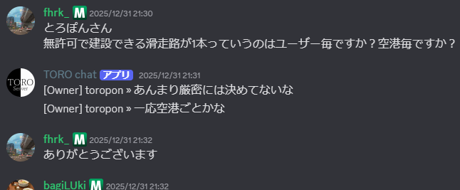

このページはよくある(かもしれない)質問集です。  
わからないことがあった場合は、まずこのページを見てみましょう。

人に質問する前に以下のことを済ませておくとよりスムーズな回答が期待できます。

- GoogleやYahooなどの検索エンジンで調べる
- このWikiやこのページに書いてないか探す
- 似たような質問がないか[Discord](../01_Guide/Discordについて.md)の過去ログから探す

(編集用) 2026/2/17: [FAQ](../01_Guide/FAQ.md)から一部の項目を統合しました。

<a id="content_1"></a>
## 目次

- [目次](#content_1)
- [よくある質問](#content_2)
  - [トラブル](#content_2_1)
    - [自分の建築が誰かに壊されている](#content_2_1_1)
    - [荒らしのログの見かたを教えてほしい](#content_2_1_2)
    - [間違えて壊しちゃった！](#content_2_1_3)
    - [下品な言葉が流れてくる！](#content_2_1_4)
    - [嫌な言葉を言われる](#content_2_1_5)
    - [ラグい！](#content_2_1_6)
  - [建築](#content_2_2)
    - [どこに建築したらいい？](#content_2_2_7)
    - [自分の建築がどこにあるかわからなくなってしまった](#content_2_2_8)
    - [滑走路は空港ごとに1個？ユーザーごとに1個？](#content_2_2_9)
  - [機能](#content_2_3)
    - [今いる場所はどこ？みんなどこにいるの？](#content_2_3_10)
    - [初期地点に戻りたい](#content_2_3_11)
    - [どんなコマンドがあるの？/コマンドの使い方を教えてほしい](#content_2_3_12)
    - [コマンドが使えない！](#content_2_3_13)
    - [WorldEdit・WorldGuard・レッドストーン回路を使いたい](#content_2_3_14)
    - [WorldEditの使い方を知りたい](#content_2_3_15)
    - [プラグインの使い方がわからない！ / 〇〇をしたい！](#content_2_3_16)
    - [WorldGuardの使い方を知りたい](#content_2_3_17)
    - [乗り物を使いたい](#content_2_3_18)
    - [乗り物の出し方・使い方を知りたい](#content_2_3_19)
    - [いきなりtpしてくる人が邪魔](#content_2_3_20)
    - [サーバーに居ない人が話してる！ / Discordって何？](#content_2_3_21)
    - [MODが動かない！](#content_2_3_22)
  - [コミュニティ](#content_2_4)
    - [tp(テレポート)してもいいの？](#content_2_4_23)
    - [この用語、どんな意味？](#content_2_4_24)
    - [画像・動画をSNSや動画サイトに投稿してもいい？](#content_2_4_25)
    - [トロッコはおやつに入りますか？](#content_2_4_26)
- [それでもわからなかった時は](#content_3)

<a id="content_2"></a>
## よくある質問

<a id="content_2_1"></a>
### トラブル

<a id="content_2_1_1"></a>
#### 自分の建築が誰かに壊されている

[荒らしを見つけたら](../01_Guide/荒らしを見つけたら.md)をご参照ください。

<a id="content_2_1_2"></a>
#### 荒らしのログの見かたを教えてほしい

/co iのコマンドを使用することで編集ログ追跡モードになり、ブロックを置いたり壊したりできなくなります。  
この時にログを知りたい場所のブロックを壊す動作をしたり、ブロックを置く動作をすると、その場所の編集ログが表示されます。  
編集ログ追跡モードを終了したい場合は、もう一度/co iコマンドを使用しましょう。

<a id="content_2_1_3"></a>
#### 間違えて壊しちゃった！

完璧に直せる場合は自分で直してください。そうでない場合は、<u>**早急に**</u>、その所有者か運営にその由を伝えてください。  
[CoreProtect](../02_Plugins/CoreProtect.md) でそのブロックの設置者を調べることができます。(消えている場合もあります。)

剣を持っているとブロックを破壊できなくなるので、誤操作が心配な方は持つようにすると良いでしょう。

<a id="content_2_1_4"></a>
#### 下品な言葉が流れてくる！

<del>[:kkj:](../01_Guide/用語集.md)したりして適当にあしらってください。</del>  
サーバー内なら、[LunaChat](../02_Plugins/LunaChat.md)の機能を利用してみてください。  
あまりにも酷い場合は、本人に直接伝えるか、運営にお知らせください。

<a id="content_2_1_5"></a>
#### 嫌な言葉を言われる

上記同様にLunachatでプレイヤーの発言を隠すことができます。また、自己責任ですがDiscordのメッセージもニックネームでフィルターできるModもあります。

```
/ch hide プレイヤー名
```

あまりにも酷い場合は、本人に直接伝えるか、運営にお知らせください。

<a id="content_2_1_6"></a>
#### ラグい！

回線的な問題であれば、こちらではどうしようもありません。  
どこかを通過したときにラグくなる(TPSが下がる)場合は、その場所に何か原因があるかもしれません。自分のものであれば改善をお願いします。そうでないものは、その所有者か運営にお伝えください。

<a id="content_2_2"></a>
### 建築

<a id="content_2_2_7"></a>
#### どこに建築したらいい？

<span style="color:#ff0000">誰かが作っている町や誰かが整地した空き地には作ってはいけません（無断改造とみなされ処罰されることがあります）。</span>  
<span style="color:#ff0000">誰かの町や土地に建築するには、その町や土地の持ち主に許可を得る必要があります。</span>

mainワールドで建築できる場所には

- フリー建築エリア
  - スポーン地点周辺区域(スポーン周辺の石の床)
  - 乾燥街(<span style="color:#fff;background-color:#000">/warp kanso_town</span>かスポーンのポータルで移動可能)
- それ以外の誰にも使われていない場所(バニラの状態)(<span style="color:#ffffff;background-color:#ff0000">注:整地された土地もダメです</span>)

の2種類があります。  
フリー建築エリアに関しては移動してから空き地をお好きに探していただいて構いませんし、それ以外の土地をお求めでしたら[Dynmap](https://map.torosaba.net)を使用して空き地を探すこともできます。  
回路やまっ平な土地に建築する事がお好きでしたらflatワールドに作ってみるのも良いでしょう  
もし他の人が土地を使っているか不安なら[CoreProtect](../02_Plugins/CoreProtect.md)を活用するか、あるいはチャットで訊いてみるのも良い選択肢ですね  
[ルール](../01_Guide/ルール.md)や[利用規約](../01_Guide/利用規約.md)に建築に関することが書かれているので、それらを守るようにしてください。

ちなみに...もし交通を建設する場合、ルール以外に[交通機関についてのルール](../03_Transportation/交通機関についてのルール.md)もよく目を通しておくことが推奨されます。

<a id="content_2_2_8"></a>
#### 自分の建築がどこにあるかわからなくなってしまった

運営に相談していただければ可能な限り探すために協力しますが、基本的にはわかりません。  
[Dynmap](http://torosaba.net:60016/)から探せば見つかるかもしれませんが、ワールドが非常に広いので難しいです。  
そうならない為にも、自分の建築の近くには/sethomeや/setwarpの[コマンド](../07_System/コマンド集.md)を使ってワープポイントを設定しておくようにしましょう。

<a id="content_2_2_9"></a>
#### 滑走路は空港ごとに1個？ユーザーごとに1個？

一応、空港毎に1個とはなっています。  
<span style="color:#ff0000">ただし、巨大建築は良識の範囲内で行いましょう。</span>  
**許可なしでは最大500mということもお忘れなく**

<https://discord.com/channels/337838758441517057/1264264554880172032/1455901253673418823>  


<a id="content_2_3"></a>
### 機能

<a id="content_2_3_10"></a>
#### 今いる場所はどこ？みんなどこにいるの？

自分のいる位置やほかの人の位置は、[Dynmap](http://torosaba.net:60016/)から確認することができます。  
また、F3キーを押すことでデバッグモードになり、自分がいる位置の座標を確認できます。

<a id="content_2_3_11"></a>
#### 初期地点に戻りたい

/spawnのコマンドでメインワールドのスポーン地点へ戻ることができます。  
また、/warp flatでフラットワールドのスポーン地点に戻ることができます。

<a id="content_2_3_12"></a>
#### どんなコマンドがあるの？/コマンドの使い方を教えてほしい

[コマンド集](../07_System/コマンド集.md)をご参照ください。

<a id="content_2_3_13"></a>
#### コマンドが使えない！

権限の設定で使えないようになっているかもしれません。[コマンド集](../07_System/コマンド集.md)やプラグインのページを参照してみてください。  
元々使用できていた場合は不具合の可能性がありますので、運営にお知らせください。

<a id="content_2_3_14"></a>
#### WorldEdit・WorldGuard・レッドストーン回路を使いたい

建築補助ツールWorldEdit（ワールドエディット）を筆頭とする各種機能をご利用いただくためには「<b>WE権限(別名:Builder権限)</b>」申請が必要です。  
TORO SERVERのDiscordでリクエストしていただくか、Discordをご利用いただけない場合はサーバー内チャットや[WorldEdit](../02_Plugins/WorldEdit.md)のコメント欄で相談してみてください。  
処罰履歴や不適切な言動等が無い限りは基本的に付与されます。  
運営が対応し次第、簡単な講習をしますのであらかじめ[WorldEdit解説ページ](../02_Plugins/WorldEdit.md)によく目を通しておきましょう。

権限取得時に運営及びSupporterより注意はあると思いますが、以下の事項をよく記憶しておいてください。

> 操作を間違えた場合は直ちに//undoを実行してください。 万が一、自分だけで操作を戻すことが難しい場合は直ちに自分で運営に報告してください。

<a id="content_2_3_15"></a>
#### WorldEditの使い方を知りたい

[WorldEdit](../02_Plugins/WorldEdit.md)をご参照ください。

<a id="content_2_3_16"></a>
#### プラグインの使い方がわからない！ / 〇〇をしたい！

| プラグイン | キーワード |
| --- | --- |
| [CoreProtect](../02_Plugins/CoreProtect.md) | ログ |
| [WorldEdit](../02_Plugins/WorldEdit.md) | 木のオノ<br>整地<br>建築補助 |
| [WorldGuard](../02_Plugins/Worldguard.md) | 保護 |
| [SnowBallGame](../02_Plugins/SnowBallGame.md) | 野球 |
| [TrainCarts](../02_Plugins/TrainCarts.md) (TBW) | トロッコ |

その他は[プラグイン・Mod・外部ツール一覧](../05_Data/プラグイン・Mod・外部ツール一覧.md)を参照してください。

<a id="content_2_3_17"></a>
#### WorldGuardの使い方を知りたい

[WorldGuard](../02_Plugins/Worldguard.md)をご参照ください。

<a id="content_2_3_18"></a>
#### 乗り物を使いたい

自動車などの乗り物を利用するためには「**Driver権限**」の申請が必要です。  
TORO SERVERのDiscordでリクエストしていただくか、Discordをご利用いただけない場合はサーバー内チャットや[Vehicles](../03_Transportation/Vehicles.md)のコメント欄で相談してみてください。  
運営が対応し次第、簡単な講習をしますのであらかじめ[Vehicles解説ページ](../03_Transportation/Vehicles.md)によく目を通しておきましょう。

権限取得時に運営及びSupporterより注意はあると思いますが、以下の事項をよく記憶しておいてください。

> 乗り物はシフト+右クリックで削除できます。遊び終わった後は必ず片付けてください。 万が一、削除できなくなった場合は直ちに自分で運営に報告してください。

<a id="content_2_3_19"></a>
#### 乗り物の出し方・使い方を知りたい

[Vehicles](../03_Transportation/Vehicles.md)をご参照ください。

<a id="content_2_3_20"></a>
#### いきなりtpしてくる人が邪魔

/tptoggleのコマンドを使用することでtpされなくなります。  
tpされなくなる状態を解除したいなら、もういちど/tptoggleコマンドを使用しましょう。

<a id="content_2_3_21"></a>
#### サーバーに居ない人が話してる！ / Discordって何？

Discordはチャットアプリで、TORO Serverではそこで様々な情報をやり取りしています。  
プラグインにより、Discordとサーバー間でチャットを送受信することができます。  
Discordへはこちらから→ [Discordについて](../01_Guide/Discordについて.md)  
[Discordの規約](https://discord.com/new/terms)上、13歳未満は使用することができないので注意してください。

<a id="content_2_3_22"></a>
#### MODが動かない！

TORO Serverのコミュニティでサポートを期待するのはやめましょう。MODは自己責任で入れるものです。

<a id="content_2_4"></a>
### コミュニティ

<a id="content_2_4_23"></a>
#### tp(テレポート)してもいいの？

人によってtpしても良かったり駄目だったりするので、/tpa などでtpしても良いかを聞いてからすると良いでしょう。  
スペクテイター状態(/gamemode 3)でtpすると相手を邪魔せずにすみます。

<a id="content_2_4_24"></a>
#### この用語、どんな意味？

[用語集](../01_Guide/用語集.md)を参照してください。

<a id="content_2_4_25"></a>
#### 画像・動画をSNSや動画サイトに投稿してもいい？

投稿することについてはかまいませんが、気を付けてほしいことが２点あります。  
１点目は、画像や動画内に映りこんでいる人々に投稿にあたっての許可をとること。  
２点目は、サーバーアドレスを載せないこと。  
基本的には以上ですが、その他の指示がある場合がありますので、あらかじめご了承ください。

<a id="content_2_4_26"></a>
#### トロッコはおやつに入りますか？

ルールにないのでOK！ｗ

<a id="content_3"></a>
## それでもわからなかった時は

Discordの質問チャンネルで質問してみましょう。  
Discordが使えないなら直接誰かに聞いてみるか、このページのコメント欄を使ってください。
