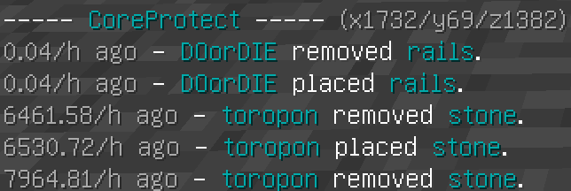

このサーバーには「CoreProtect」というブロック操作履歴を記録するプラグインが導入されており、  
誰がブロックを設置したか等を調べることができます。

**目次**

- [使い方](#content_1)
  - [機能のON・OFF](#content_1_1)
  - [ログの取り方](#content_1_2)
  - [ログの見方](#content_1_3)
- [コマンド一覧](#content_2)
  - [一般](#content_2_4)
  - [運営向け](#content_2_5)
    - [パラメータ](#content_2_5_1)

## 使い方

### 機能のON・OFF

ブロック操作履歴の確認機能を有効にするには、<b>/co i</b> と実行します。  
CoreProtect - Inspector now enabled. と表示されると有効になります。

無効にする際も、<b>/co i</b> と実行します。  
CoreProtect - Inspector now disabled. と表示されると無効になります。

### ログの取り方

機能を有効にした後、ブロックを**左クリック**すると、その位置のログを取得できます。  
また、**右クリック**すると、クリックしたその面の上の位置のログを取得できます。

レバーやドアなどの右クリックで変化するブロックは、**右クリック**で使用履歴を取得できます。（左クリック時は上記と同じ）

### ログの見方

- ----- CoreProtect ----- <u><b>(x座標/y座標/z座標)</b></u> ← どこのログを見ているかを表しています。
- <u>**x.xx/h ago**</u> ← 何時間前に編集されたかを表しています。(「h」は「hour」の略で、日本語で「〜時間」という意味です。)
- x.xx/h ago - <u>**DOorDIE**</u> ← 編集した人を表しています。
- x.xx/h ago - DOorDIE <u>**removed**</u> ← ブロックを取り除いたことを表しています。
- x.xx/h ago - DOorDIE <u>**placed**</u> ← ブロックを設置したことを表しています。
- x.xx/h ago - DOorDIE placed <u>**rails**</u> ← レールを設置したことを表しています。

ロールバックされたものは x.xx/h ago - ~~DOorDIE~~ ~~placed~~ ~~rails~~ のように取り消し線が引かれています。  
ページがある場合は、<b>/co l ページ数</b> でページを変えることができます。

## コマンド一覧

### 一般

| コマンド | 説明 | 短縮形 |
| --- | --- | --- |
| /co inspect | ログ取得モードのON,OFF | /co i |
| /co lookup <ページ> | 取得したログのページ替え | /co l |

### 運営向け

| コマンド | 説明 | 短縮形 |
| --- | --- | --- |
| /co lookup <パラメータ> | 指定したパラメータでログ情報を取得 | /co l |
| /co near | 自身を中心に半径5ブロック内のログを取得 (多少時間がかかります) |  |
| /co rollback <パラメータ> | 指定したパラメータのログをもとに巻き戻す | /co rb |
| /co restore <パラメータ> | 指定したパラメータでrollbackした部分を戻す | /co rs |
| /co undo | rollbackまたはrestoreしたことを取り消す |  |

#### パラメータ

| パラメータ | 説明 | 例 |
| --- | --- | --- |
| u:<プレイヤー名> | プレイヤーを指定 「,」で複数指定可 | u:Steve |
| t:<時間> | 現在からの時間の範囲を指定 1w=1週間,1d=1日,1h=1時間,1m=1分,1s=1秒 | t:2d |
| r:<範囲> | 範囲を指定 10=半径10ブロック,#global=サーバー内のワールド全体, #<ワールド名>=指定ワールド全体,#we=WorldEditの指定範囲 | r:#main |
| a:<行動> | 行動を指定 block=ブロック設置と破壊(+block=設置,-block=破壊),click=右クリック, container=チェストへの出し入れ(+container=入れ,-container=出し),kill=mob殺害 | a:-block |
| b:<ブロック> | ブロックを指定 「,」で複数指定可 | b:tnt,lava |
| e:<ブロック> | ブロックを除外 「,」で複数指定可 | e:stone,dirt |
| #preview | rollbackまたはrestoreを実行する前に確認をいれる |  |
| #verbose | rollbackまたはrestore時の追加情報を表示 |  |
| #silent | rollbackまたはrestore時の情報を最小限にする |  |

例：Steveの2日前までの行動をメインワールド内の範囲で確認つきでロールバックする

> /co rb u:Steve t:2d r:#main #preview

例：Steveの10時間前までに設置した水と溶岩とそれらによって生成されたブロックをWorldEditで指定した範囲でロールバックする

> /co rb u:Steve,#water,#lava a:+block b:stone,cobblestone,obsidian,water,flowing_water,lava,flowing_lava t:10h r:#we

---

[公式コマンド一覧（英語）](http://minerealm.com/community/viewtopic.php?f=32&t=6781)

他、わからないことがございましたら運営や他の住民の方へお聞きいただけると幸いです。
