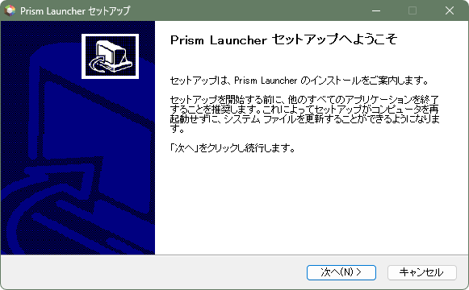
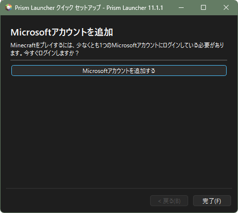
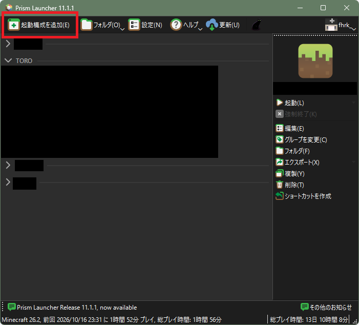
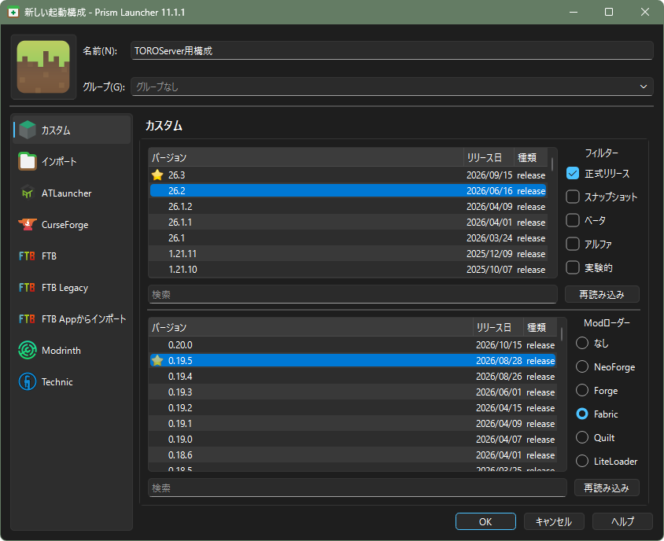
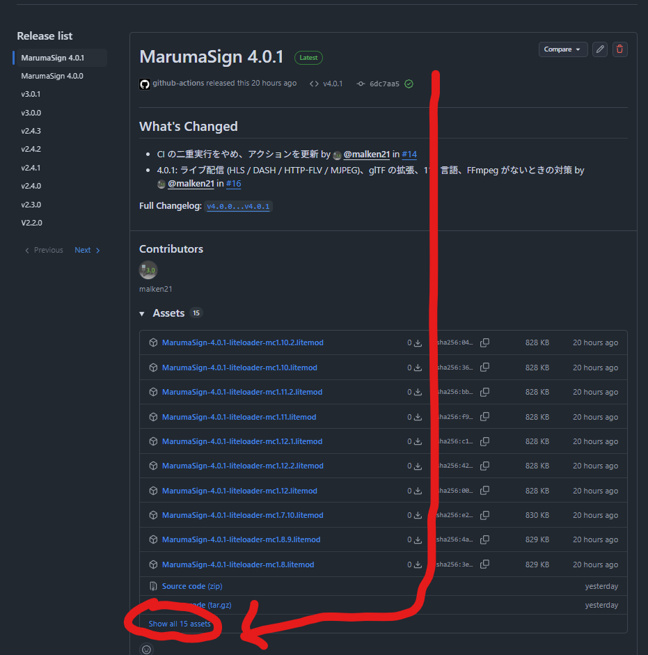
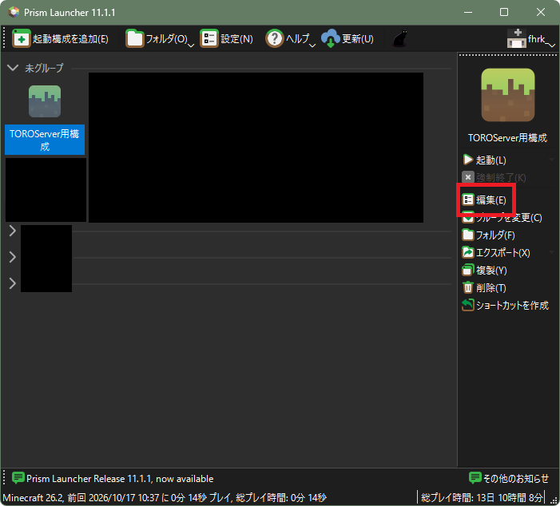
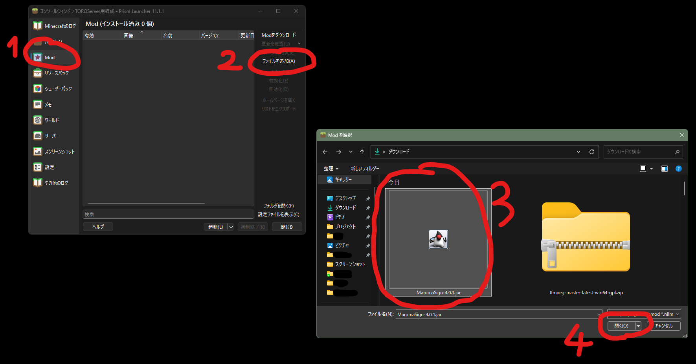
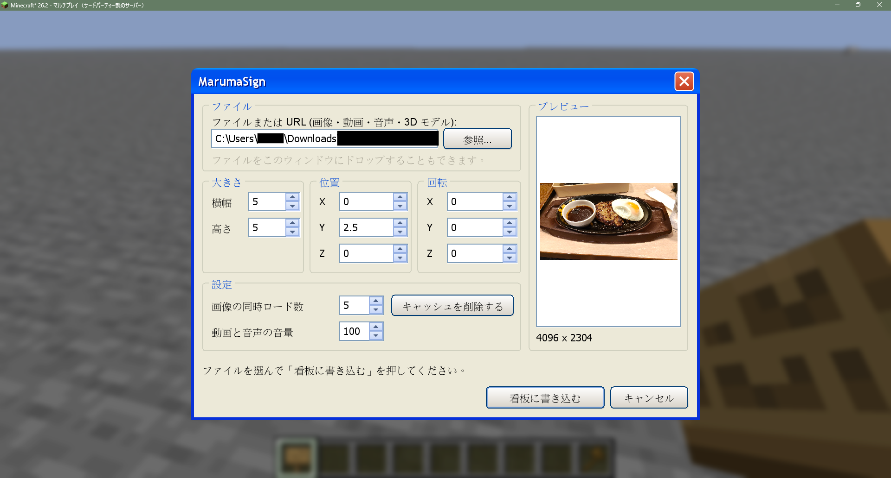
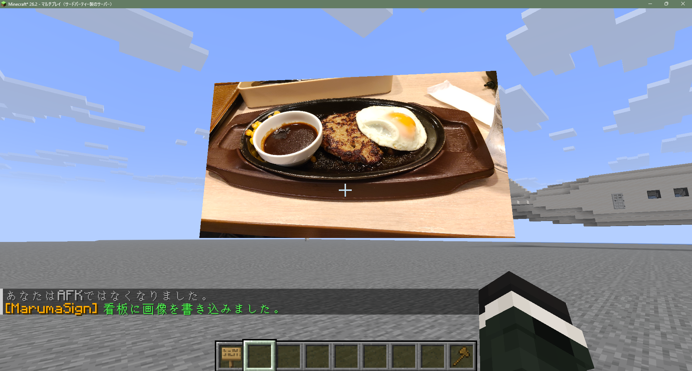

<a id="content_1"></a>
## 概要

MarumaSignとは、AdminのMarumasaUSB氏が長きにわたり保守しているModです。  
マインクラフト内にウェブからフェッチした画像を表示することができます。  
4.0から、音声/動画/3Dモデルにも対応しました。4.0からFabric/Forge/NeoForge/LiteLoaderで動くようです。

Adminしゃけ氏の解説動画 (**MarumaSignバージョン4.0未満の情報です**)

[YouTube: 【Minecraft 1.20.1 Mod】Marumasa Sign 導入解説](https://www.youtube.com/watch?v=Q_wa4wSbZCk)

<a id="content_2"></a>
## 目次

- [概要](#content_1)
- [目次](#content_2)
- [導入手順](#content_3)
  - [1. Modローダーの導入](#content_3_1)
    - [Prism Launcherの導入](#content_3_1_1)
    - [Fabric Loaderの導入](#content_3_1_2)
  - [2. FFmpegの導入](#content_3_2)
  - [3. MarumaSignを追加](#content_3_3)
- [使用方法](#content_4)
- [互換性](#content_5)

<a id="content_3"></a>
## 導入手順

<a id="content_3_1"></a>
### 1. Modローダーの導入

すでにFabric, NeoForge, Forgeのいずれかが導入されている人は次章へスキップ可能です。  
この導入ガイドでは、1.19以降の主流ModローダーであるFabricを推奨します。  
また、この導入ガイドでは詳しくない人でもクリックだけでMod管理ができるサードパーティーランチャーソフトと呼ばれるソフトウェアを用いて進めていきます。

<a id="content_3_1_1"></a>
#### Prism Launcherの導入

この導入ガイドではオープンソースで軽量で広告などが付いてないPrism Launcherを導入してみます。  
まずは下記リンクからダウンロードして、インストーラーを起動します。  
<https://prismlauncher.org/download/>  
インストーラーは基本的に次へでOKです。  
英語読めるなら、お好みのちょっとした設定ができます。  
スタートメニューに追加しますか?とかデスクトップにショートカットを追加しますか?って訊かれてるだけです。

| 下の画像はWindowsの場合。 |
| --- |
|  |

導入し終えたら、起動してみましょう。  
以下の画面が出てきたらOKです。Microsoftアカウントを追加を押します。  
そして、「Microsoftアカウントにサインイン」を押してログインを済ませれば、ホーム画面に移動できるはずです。



<a id="content_3_1_2"></a>
#### Fabric Loaderの導入

「起動構成を追加」をクリックします。



「カスタム」を選んでバージョンは正式リリースの「26.2」  
Modローダーは「Fabric」を選んでから、できるだけリリース日が新しいものを選択し、OKを押します。



これで起動構成ができました。ホームで右のバーの「起動」をクリックして、問題なく起動することを確認したらインストールは終了です。

<a id="content_3_2"></a>
### 2. FFmpegの導入

FFmpegとは、主に動画などのメディアを操作するために非常に昔から保守されてきたOSS(オープンソースソフトウェア)です。  
本項では、環境ごとに導入方法が異なります。

<details>
<summary>🪟Windows</summary>

Windowsキー+Rで「ファイル名を指定して実行」を開きます。そしたら、cmdと入力しエンターを押します。  
出てきた画面に以下のコマンドを入力してエンターでインストールします。

```sh
winget install --id Gyan.FFmpeg -e
```

インストール後、以下のコマンドを実行してcommand not foundにならなければ、成功です。

```sh
ffmpeg -version
```

</details>

<details>
<summary>🍟macOS</summary>

| この記事の作成者は生まれてこのかたmacOSを触ったことがありません。つまり、未検証です。 |
| --- |

Spotlightを開いて「Terminal」と入力すればターミナルが開けるはずです。  
そうしたら、

```sh
brew -v
```

を実行し、command not foundと出てきたら以下のコマンドを実行してください。出てこなかった人はやらなくていいです。

```sh
/bin/bash -c "$(curl -fsSL https://raw.githubusercontent.com/Homebrew/install/HEAD/install.sh)"
```

そして以下のコマンドでインストールします。

```sh
brew install ffmpeg
```

インストール後、以下のコマンドを実行してcommand not foundにならなければ、成功です。

```sh
ffmpeg -version
```

</details>

<details>
<summary>🐧Linux</summary>

ターミナルで以下のコマンドを実行します。  
<b>このディストリビューションの場合: Debian, Ubuntu, Kubuntu, Lubuntu, Xubuntu, Linux Mint, etc.</b>

```sh
sudo apt update && sudo apt install ffmpeg
```

<b>このディストリビューションの場合: CentOS, Rocky Linux, RHEL, etc.</b>

```sh
sudo dnf install epel-release && sudo dnf install ffmpeg
```

**このディストリビューションの場合: Arch Linux派生OSなど**

```sh
sudo pacman -S ffmpeg
```

インストール後、以下のコマンドを実行してバージョンが出てくれば成功です。

```sh
ffmpeg -version
```

</details>

<a id="content_3_3"></a>
### 3. MarumaSignを追加

MarumaSign本体をダウンロードしましょう。以下のサイトにアクセスして「Show all <数字> assets」の部分をクリックしてください。  
<https://github.com/TORO-Server/MarumaSign/releases>



そして、「MarumaSign-バージョン番号.jar」というファイルをダウンロードします。  
Prism Launcherに戻ります。起動構成を選んで右側バーの「編集」をクリックし、続けて「Mod」をクリックしてください。



そして、「ファイルを追加」からMarumaSignのjarファイルを選んで開きます。



これで導入は完了です。「起動」ボタンで起動しましょう。

<a id="content_4"></a>
## 使用方法

デフォルトでBキー(26.3ではデフォルトでF9キー、いずれも設定からキーを変更可能)で、MarumaSignの設定 兼 新規作成画面を開けます。  
ファイルを選び、座標などを調節して「看板に書き込む」を押したあと、看板を設置することで表示が可能です。





<a id="content_5"></a>
## 互換性

MarumaSignの対応しているファイル形式/コーデックはFFmpegのバージョンや環境により左右する可能性があります。

FFmpegの対応しているメディア形式:

- 動画: MP4, MOV, MKV, AVI, FLV, WebM, MXF, TS, M2TS, WMV, OGV など
- 音声: MP3, AAC, WAV, FLAC, Ogg Vorbis, Opus, WMA, AIFF など
- 画像: PNG, JPEG, GIF, BMP, TIFF, WebP

また、MarumaSignはglTF形式(.gltf, .glb)の3Dモデルが読み込めます。  
3Dモデル読み込みにおける制限は以下の通りです: (README.mdより)

- 三角形は 15 万枚まで、ファイルは外部ファイルを含めて 64 MB まで
- 透過 (transmission) は屈折を計算せず、半透明として表示します。分散 (dispersion) は見た目に反映しません
- カメラの定義は使いません
- 上に挙げていない拡張が必須 (extensionsRequired) のモデルは読み込めません

また、シェダーパック(影mod)との互換性も公式に確認されているようです。詳しくはここから。  
<https://github.com/TORO-Server/MarumaSign/blob/main/docs/verification.md>

4.1からライブ配信に対応しました。上級者向けですが、ライブ配信の読み込みが可能なようです。詳しくは公式のREADME.mdから。

<details>
<summary>2026/10/15以前の情報</summary>

## 注意事項

ModはJava版限定要素となっております。  
BEでも見えるように画像を使いたかったら→[ImageOnMap](../02_Plugins/プラグイン：ImageOnMap.md)

## 概要

MarumaSignは、画像をマイクラ内で表示するModです。  
AdminのMarumasaUSBさんが作りました。  


## 目次

- [概要](#content_1)
- [目次](#content_2)
- [導入手順](#content_3)
  - [1. Modローダーの導入](#content_3_1)
    - [Prism Launcherの導入](#content_3_1_1)
    - [Fabric Loaderの導入](#content_3_1_2)
  - [2. FFmpegの導入](#content_3_2)
  - [3. MarumaSignを追加](#content_3_3)
- [使用方法](#content_4)
- [互換性](#content_5)

## 画像を表示してみよう！

### 1.導入する (2026/09/18時点)

事前に[FabricMC](https://fabricmc.net/use/installer/)、[FabricAPI](https://www.curseforge.com/minecraft/mc-mods/fabric-api/files)をダウンロードしておいてください。  
ついでに、Indiumの導入もお勧めします。(Sodium 0.6.0未満をご利用の方のみ)

26.2について：Sodium等の一部の描画Modと併用すると正常に描画されない不具合あり

| Minecraft | MarumaSign |
| --- | --- |
| 26.2 | [26.2(Github)](https://github.com/TORO-Server/MarumaSign/releases/tag/v3.0.1) |
| 1.21.1 | [2.4.3(CurseForge)](https://www.curseforge.com/minecraft/mc-mods/marumasign/files/6998604) |
| 1.21 | [2.3.0(CurseForge)](https://www.curseforge.com/minecraft/mc-mods/marumasign/files/5454021) |
| 1.20.6 | [2.2.0(CurseForge)](https://www.curseforge.com/minecraft/mc-mods/marumasign/files/5454020) |
| 1.20.5 | [2.1.0(Github)](https://github.com/TORO-Server/MarumaSign/releases/tag/v2.1.0) |
| 1.20.4 | [2.0.2(CurseForge)](https://www.curseforge.com/minecraft/mc-mods/marumasign/files/5236126) |
| 1.20.3 | [1.7.0(Github)](https://github.com/TORO-Server/MarumaSign/releases/tag/v1.7.0) |
| 1.20.2 | [1.6.0(Github)](https://github.com/TORO-Server/MarumaSign/releases/tag/v1.6.0) |
| 1.20.1 | [1.5.0(Github)](https://github.com/TORO-Server/MarumaSign/releases/tag/v1.5.0) |

まず、FabricMC公式ページの手順に従って、Fabricをインストール。  
FabricAPIとMarumaSignをmodsフォルダに配置して準備完了。

### 2.設置してみる

WebUIを開きます。(初期キー：B)  
画像をアップロードして、giveコマンド実行を押せば取得できます。  
<span style="color:#ffffff;background-color:#ff0000">注意事項：2024/12/20現在、このサーバーのバージョンは1.20.4なのでMarumaSignもそれに合わせてください。</span>

#### パラメーター一覧

| 画像アドレス | 画像のURL |
| --- | --- |
| 横幅 | 看板の横の大きさ |
| 高さ | 看板の縦の大きさ |
| ?軸位置 | 看板の相対的位置 |
| ?軸回転 | 看板の角度等 |

</details>
