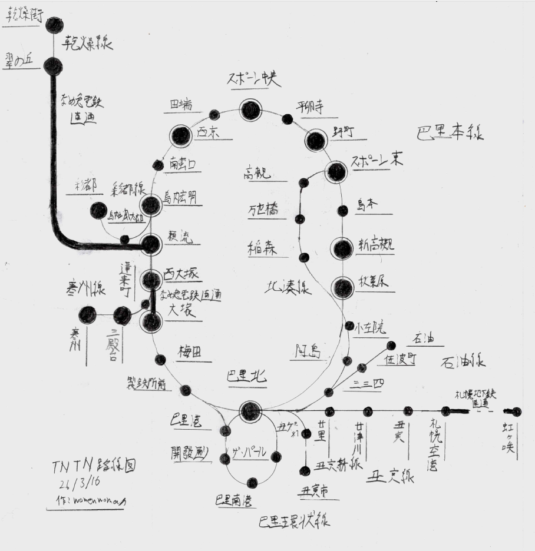
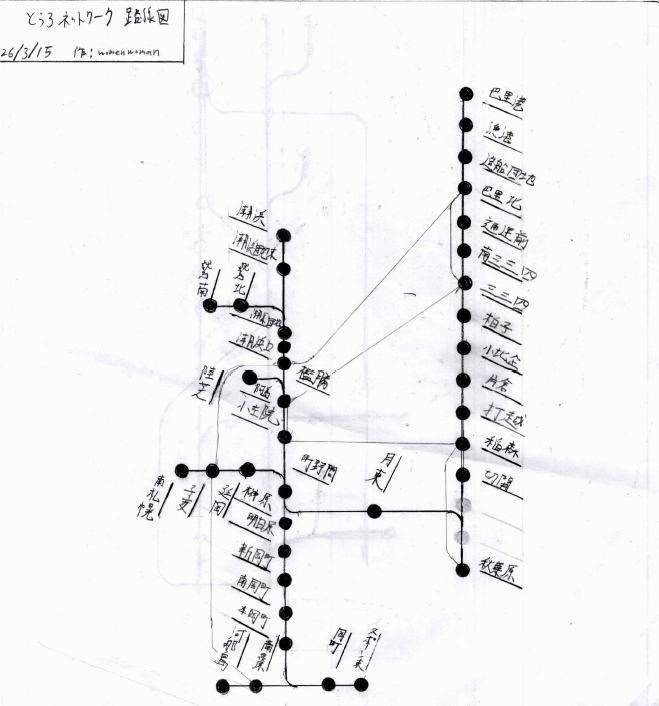

このページではTNTN（toro normal train network）について紹介します。

## TNTNとは？

TNTNは、鉄道、駅周辺開発を担う鉄道会社です。和名は、トロ標準鉄道会社。  
また、TNTNはサーバー最古の鉄道であり、一番長くこのサーバーにおける信頼を得ております。

### 路線図

## TNTNが保有する鉄道

### 巴里本線（緩行線）

| 起点 | 大塚 |
| --- | --- |
| 終点 | 島内宏明 |
| 所有者 | TNTN |
| 路線総延長 | 計測中 |
| 軌間 | 1432mm（標準軌） |
| 電化 | 直流1,500 V 架空電車線方式 |
| 運行速度 | 営業最高速度130km/h 試験最高速度 180km/h |

信号場・施設

| 大塚 | 0km地点 | MRと接続。なめ急電鉄と直通開始。 |
| --- | --- | --- |
| 梅田 | -km地点 | 1面2線の駅。 |
| 製鉄所前 | -km地点 | 1面2線の駅。 |
| 巴里北 | -km地点 | とうろネットワーク線、南呂電鉄と接続。巴里本線、巴里環状線と分岐。 |
| 秋葉原 | -km地点 | 寿司鉄道、とうろネットワーク線と接続。 |
| 新高槻 | -km地点 | 高槻電鉄、寿司鉄道と接続。 |
| 島本 | -km地点 | 1面2線の駅。高槻電鉄、寿司鉄道、東呂地方鉄道と接続。 |
| スポーン東 | -km地点 | 高槻電鉄、寿司鉄道、とうろネットワーク線と接続。 |
| 野町 | -km地点 | スポーン地下鉄、赤城急行電鉄と接続。 |
| 平卵寺 | -km地点 | 1面2線の駅。 |
| スポーン中央 | -km地点 | 平原高速鉄道、MR、スポーン地下鉄、赤城急行線と接続。 |
| 田端 | -km地点 | MRと接続。 |
| 西京 | -km地点 | 高槻電鉄、MRと接続。空港最寄り駅。 |
| 南蛮口 | -km地点 | 1面2線の駅。南蛮LRTと接続。 |
| 島内宏明 | -km地点 | 彩都線、寒州線と分岐。 |

### 巴里本線（快速線）

| 起点 | 大塚 |
| --- | --- |
| 終点 | 島内宏明 |
| 所有者 | TNTN |
| 路線総延長 | 計測中 |
| 軌間 | 1432mm（標準軌） |
| 電化 | 直流1,500 V 架空電車線方式 |
| 運行速度 | 営業最高速度130km/h 試験最高速度 180km/h |

信号場・施設

| 大塚 | 0km地点 | MRと接続。なめ急電鉄と直通開始。 |
| --- | --- | --- |
| 巴里北 | -km地点 | とうろネットワーク線、南呂電鉄と接続。巴里本線、巴里環状線と分岐。 |
| 秋葉原 | -km地点 | 寿司鉄道、とうろネットワーク線と接続。 |
| 新高槻 | -km地点 | 高槻電鉄、寿司鉄道と接続。 |
| スポーン東 | -km地点 | 高槻電鉄、寿司鉄道、とうろネットワーク線と接続。 |
| 野町 | -km地点 | スポーン地下鉄、赤城急行電鉄と接続。 |
| スポーン中央 | -km地点 | 平原高速鉄道、MR、スポーン地下鉄、赤城急行線と接続。 |
| 西京 | -km地点 | 高槻電鉄、MRと接続。空港最寄り駅。 |
| 島内宏明 | -km地点 | 彩都線、寒州線と分岐。JPR島双線と接続。 |

### 彩都線

| 起点 | 島内宏明 |
| --- | --- |
| 終点 | 彩都 |
| 所有者 | TNTN |
| 路線総延長 | 計測中 |
| 軌間 | 1432mm（標準軌） |
| 電化 | 直流1,500 V 架空電車線方式 |
| 運行速度 | 最高速度130km/h |

信号場・施設

| 島内宏明 | 0km地点 | 巴里本線、寒州線と分岐。 |
| --- | --- | --- |
| 島内颯太郎 | -km地点 | 1面2線の駅。 |
| 彩都 | -km地点 | 平原高速鉄道、赤城急行電鉄、彩都市営地下鉄と接続。 |

### 寒州線

| 起点 | 島内宏明 |
| --- | --- |
| 終点 | 寒州 |
| 所有者 | TNTN |
| 路線総延長 | 計測中 |
| 軌間 | 1432mm（標準軌） |
| 電化 | 直流1,500 V 架空電車線方式 |
| 運行速度 | 最高速度130km/h |

信号場・施設

| 島内宏明 | 0km地点 | 巴里本線、彩都線と分岐。 |
| --- | --- | --- |
| 籟流 | -km地点 | 高槻電鉄、T鉄、島内電車と接続。なめ急とここで直通開始。 |
| 西大塚 | -km地点 | 北泉鉄道、島内電車、TRと接続。なめ急とここで直通開始。 |
| 蓬莱町 | -km地点 | TR、なめ急と接続。 |
| 三殿台 | -km地点 | 2面2線の駅。 |
| 寒州 | -km地点 | T鉄と接続。 |

### 丑寅線

| 起点 | 巴里北 |
| --- | --- |
| 終点 | 札幌空港 |
| 所有者 | TNTN |
| 路線総延長 | 計測中 |
| 軌間 | 1432mm（標準軌） |
| 電化 | 直流1,500 V 架空電車線方式 |
| 運行速度 | 最高速度100km/h |

信号場・施設

| 巴里北 | 0km地点 | とうろネットワーク線、南呂電鉄と接続。巴里本線、巴里環状線と分岐。 |
| --- | --- | --- |
| 廿里 | -km地点 | 高槻電鉄と接続。 |
| 廿津川 | -km地点 | 寿司鉄道と接続。 |
| 丑寅 | -km地点 | 丑寅電鉄、高槻電鉄、丑寅電鉄市内線と接続。 |
| 札幌空港 | -km地点 | 札幌地下鉄と直通。 |

### 丑寅新線

| 起点 | 巴里北 |
| --- | --- |
| 終点 | 丑寅市 |
| 所有者 | TNTN |
| 路線総延長 | 計測中 |
| 軌間 | 1432mm（標準軌） |
| 電化 | 直流1,500 V 架空電車線方式 |
| 運行速度 | 最高速度100km/h |

信号場・施設

| 巴里北 | 0km地点 | とうろネットワーク線、南呂電鉄と接続。巴里本線、巴里環状線と分岐。 |
| --- | --- | --- |
| 丑寅ゲートウェイ | -km地点 | 1面2線の駅。 |
| 丑寅市 | -km地点 | 寿司鉄道、高槻電鉄、丑寅電鉄、丑寅市内線と接続。 |

### 乾燥線

| 起点 | 翠の丘 |
| --- | --- |
| 終点 | 乾燥街 |
| 所有者 | TNTN |
| 路線総延長 | 計測中 |
| 軌間 | 1432mm（標準軌） |
| 電化 | 直流1,500 V 架空電車線方式 |
| 運行速度 | 最高速度140km/h |

信号場・施設

| 翠の丘 | 0km地点 | なめ急電鉄と接続。 |
| --- | --- | --- |
| 乾燥街 | -km地点 | 磯崎電鉄、RRと接続。 |

### 北湊線

| 起点 | 巴里北 |
| --- | --- |
| 終点 | スポーン東 |
| 所有者 | TNTN |
| 路線総延長 | 計測中 |
| 軌間 | 1432mm（標準軌） |
| 電化 | 直流1,500 V 架空電車線方式 |
| 運行速度 | 最高速度100km/h |

信号場・施設

| 巴里北 | 0km地点 | とうろネットワーク線、南呂電鉄と接続。巴里本線、巴里環状線と分岐。 |
| --- | --- | --- |
| 三三四 | -km地点 | とうろネットワーク線と接続。 |
| 阿島 | -km地点 | とうろネットワーク線と接続。 |
| 小左院 | -km地点 | とうろネットワーク線と接続 |
| 稲森 | -km地点 | とうろネットワーク線と接続。 |
| 万世橋 | -km地点 | 1面２線の駅。 |
| 高槻 | -km地点 | 高槻電鉄と接続。 |
| スポーン東 | -km地点 | 巴里本線、とうろネットワーク線、高槻電鉄、寿司鉄道と接続。 |

### 石油線

| 起点 | 巴里北 |
| --- | --- |
| 終点 | 石油 |
| 所有者 | TNTN |
| 路線総延長 | 計測中 |
| 軌間 | 1432mm（標準軌） |
| 電化 | 直流1,500 V 架空電車線方式 |
| 運行速度 | 最高速度80km/h |

信号場・施設

| 巴里北 | 0km地点 | とうろネットワーク線、南呂電鉄と接続。巴里本線、巴里環状線と分岐。 |
| --- | --- | --- |
| 三三四 | -km地点 | とうろネットワーク線と接続。 |
| 佐波町 | -km地点 | 高槻電鉄と接続。 |
| 石油 | -km地点 | 1面1線の駅。 |

### 巴里環状線

| 起点 | 巴里北 |
| --- | --- |
| 終点 | 巴里北 |
| 所有者 | TNTN |
| 路線総延長 | 計測中 |
| 軌間 | 1432mm（標準軌） |
| 電化 | 直流1,500 V 架空電車線方式 |
| 運行速度 | 最高速度80km/h |

信号場・施設

| 巴里北 | 0km地点 | とうろネットワーク線、南呂電鉄と接続。巴里本線、巴里環状線と分岐。 |
| --- | --- | --- |
| ザ・パール | -km地点 | 1面2線の駅。 |
| 巴里南港 | -km地点 | 北泉鉄道と接続。 |
| 開發通り | -km地点 | T鉄と接続。 |
| 巴里港 | -km地点 | とうろネットワーク線と接続。 |
| 巴里北 | -km地点 | とうろネットワーク線、南呂電鉄と接続。巴里本線、巴里環状線と分岐。 |

## TNTNが保有する鉄道車両

## TNTN行っているその他の事業

## とうろネットワーク

とうろネットワークとは、旧TNTN岡町線、巴里市内線、旧東呂地方鉄道の一部路線を分離させ、地域ネットワークとして再編成した鉄道事業です。

### 路線図

### 東1系統

| 起点 | スポーン東 |
| --- | --- |
| 終点 | 河那島 |
| 所有者 | とうろネットワーク |
| 路線総延長 | 計測中 |
| 軌間 | 1432mm（標準軌） |
| 電化 | 直流600 V 架空電車線方式 |
| 運行速度 | 最高速度60km/h |

信号場・施設

| スポーン東 | 0km地点 | 東2系統と分岐。　高槻電鉄、寿司鉄道、TNTNと接続。 |
| --- | --- | --- |
| 岡町 | -km地点 | 高槻電鉄と接続。 |
| 南泉原 | -km地点 | 輪山電鉄、高槻電鉄と接続。 |
| 河那島 | -km地点 | 河那島電鉄と接続。 |

### 東2系統

| 起点 | スポーン東 |
| --- | --- |
| 終点 | 町野間 |
| 所有者 | とうろネットワーク |
| 路線総延長 | 計測中 |
| 軌間 | 1432mm（標準軌） |
| 電化 | 直流600 V 架空電車線方式 |
| 運行速度 | 最高速度50km/h |

信号場・施設

| スポーン東 | 0km地点 | 東2系統と分岐。　高槻電鉄、寿司鉄道、TNTNと接続。 |
| --- | --- | --- |
| 岡町 | -km地点 | 高槻電鉄と接続。 |
| 本岡町 | -km地点 |  |
| 南岡町 | -km地点 | 赤木急行電鉄と接続。 |
| 新岡町 | -km地点 |  |
| 明日原 | -km地点 |  |
| 榊原 | -km地点 | 輪山電鉄と接続。 |
| 町野間 | -km地点 | とうろネットワーク線と分岐。 |

### 秋1系統

| 起点 | 秋葉原 |
| --- | --- |
| 終点 | 巴里港 |
| 所有者 | とうろネットワーク |
| 路線総延長 | 計測中 |
| 軌間 | 1432mm（標準軌） |
| 電化 | 直流600 V 架空電車線方式 |
| 運行速度 | 最高速度60km/h |

信号場・施設

| 秋葉原 | 0km地点 | とうろネットワークと分岐。　寿司鉄道、TNTNと接続。 |
| --- | --- | --- |
| 切開 | -km地点 |  |
| 稲森 | -km地点 | TNTNと接続。 |
| 打越 | -km地点 |  |
| 片倉 | -km地点 |  |
| 小比企 | -km地点 |  |
| 柏子 | -km地点 |  |
| 三三四 | -km地点 | TNTNと接続。 |
| 南三三四 | -km地点 |  |
| 通運前 | -km地点 |  |
| 巴里北 | -km地点 | とうろネットワーク線、南呂電鉄と接続。巴里本線、巴里環状線と分岐。 |
| 造船団地 | -km地点 |  |
| 漁港 | -km地点 |  |
| 巴里港 | -km地点 | とうろネットワークと分岐。TNTNと接続。 |

### 秋2系統

| 起点 | 秋葉原 |
| --- | --- |
| 終点 | 潮浜 |
| 所有者 | とうろネットワーク |
| 路線総延長 | 計測中 |
| 軌間 | 1432mm（標準軌） |
| 電化 | 直流600 V 架空電車線方式 |
| 運行速度 | 最高速度60km/h |

信号場・施設

| 秋葉原 | 0km地点 | とうろネットワークと分岐。　寿司鉄道、TNTNと接続。 |
| --- | --- | --- |
| 月東 | -km地点 |  |
| 町野間 | -km地点 | とうろネットワークと分岐。 |
| 小左院 | -km地点 | TNTNと接続。 |
| 阿島 | -km地点 | とうろネットワークと分岐。TNTNと接続。 |
| 檻勝 | -km地点 | 高槻電鉄と接続。 |
| 潮浜口 | -km地点 |  |
| 潮浜団地 | -km地点 | とうろネットワークと分岐。 |
| 潮浜団地東 | -km地点 |  |
| 潮浜 | -km地点 |  |

### 秋3系統

| 起点 | 秋葉原 |
| --- | --- |
| 終点 | 南札幌 |
| 所有者 | とうろネットワーク |
| 路線総延長 | 計測中 |
| 軌間 | 1432mm（標準軌） |
| 電化 | 直流600 V 架空電車線方式 |
| 運行速度 | 最高速度60km/h |

信号場・施設

| 秋葉原 | 0km地点 | とうろネットワークと分岐。　寿司鉄道、TNTNと接続。 |
| --- | --- | --- |
| 月東 | -km地点 |  |
| 町野間 | -km地点 | とうろネットワークと分岐。 |
| 延岡 | -km地点 |  |
| 子安 | -km地点 | 高槻電鉄と接続。 |
| 南札幌 | -km地点 | 東呂地方鉄道と直通開始。丑寅電鉄と接続。 |

### 秋4系統

| 起点 | 秋葉原 |
| --- | --- |
| 終点 | 陸芝 |
| 所有者 | とうろネットワーク |
| 路線総延長 | 計測中 |
| 軌間 | 1432mm（標準軌） |
| 電化 | 直流600 V 架空電車線方式 |
| 運行速度 | 最高速度60km/h |

信号場・施設

| 秋葉原 | 0km地点 | とうろネットワークと分岐。　寿司鉄道、TNTNと接続。 |
| --- | --- | --- |
| 月東 | -km地点 |  |
| 町野間 | -km地点 | とうろネットワークと分岐。 |
| 小左院 | -km地点 | TNTNと接続。 |
| 阿島 | -km地点 | とうろネットワークと分岐。TNTNと接続。 |
| 陸芝 | -km地点 |  |

### 秋4系統

| 起点 | 秋葉原 |
| --- | --- |
| 終点 | 鷲羽団地南 |
| 所有者 | とうろネットワーク |
| 路線総延長 | 計測中 |
| 軌間 | 1432mm（標準軌） |
| 電化 | 直流600 V 架空電車線方式 |
| 運行速度 | 最高速度60km/h |

信号場・施設

| 秋葉原 | 0km地点 | とうろネットワークと分岐。　寿司鉄道、TNTNと接続。 |
| --- | --- | --- |
| 月東 | -km地点 |  |
| 町野間 | -km地点 | とうろネットワークと分岐。 |
| 小左院 | -km地点 | TNTNと接続。 |
| 阿島 | -km地点 | とうろネットワークと分岐。TNTNと接続。 |
| 檻勝 | -km地点 | 高槻電鉄と接続。 |
| 潮浜口 | -km地点 |  |
| 潮浜団地 | -km地点 | とうろネットワークと分岐。 |
| 鷲羽団地北 | -km地点 |  |
| 鷲羽団地南 | -km地点 |  |

### 巴2系統

### 巴3系統

### 巴4系統

### 巴5系統

### 巴6系統

### 巴7系統

### 巴8系統
