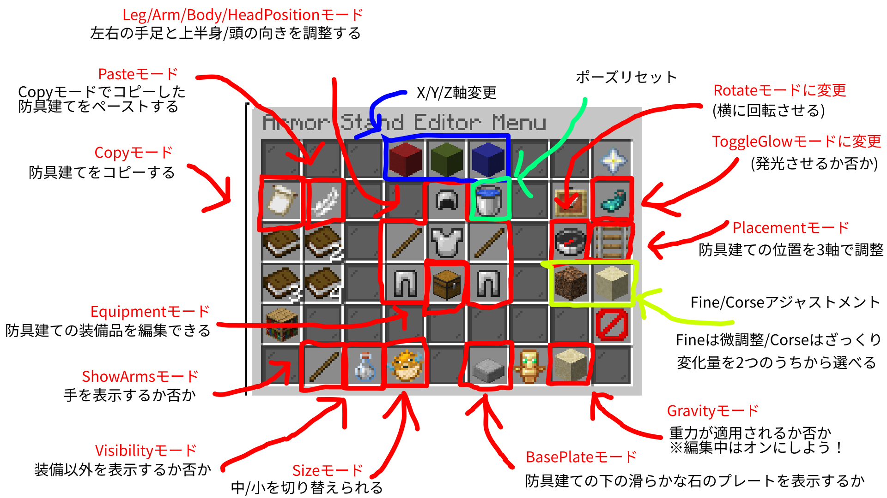

ArmorStandEditorは、防具建てを思うようにカスタマイズして装飾に使うためのツールです。  

### 目次

* [目次](#content_1)
* [使い方](#content_2)
  + [メニューを開く](#content_2_1)
  + [メニューの見方](#content_2_2)

### 使い方

まずは、編集対象の防具建てを置いてください。次に火打石(minecraft:flint)を使います。

#### メニューを開く

火打石を持ちながら防具建て**ではない場所**に向かって右クリックすると開ける  
ここからは「モード切り替え→防具建てに向かって右/左クリック→またモード切り替え」を繰り返して編集していきます。

#### メニューの見方

