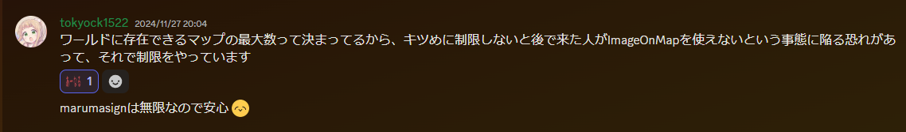
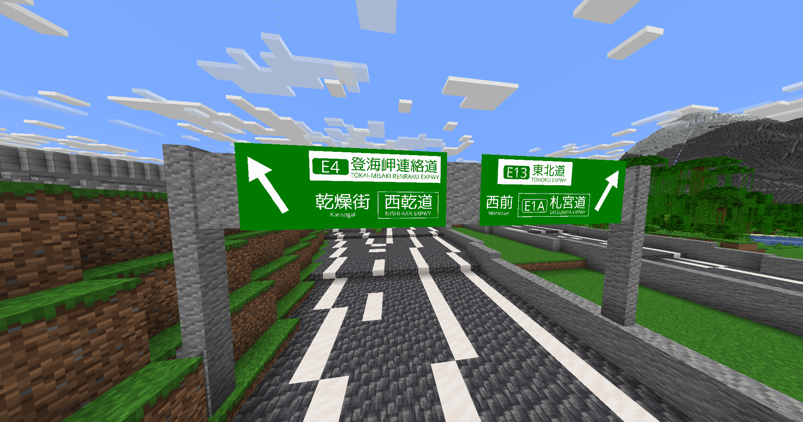

<table>
<tr><td colspan="3" style="background-color:#bbb"></td></tr>
<tr><td style="background-color:#bbb"></td><td style="background-color:#ddd">このプラグインは1.20.4以前で動作していました。</td><td style="background-color:#bbb"></td></tr>
<tr><td style="background-color:#bbb"></td><td style="background-color:#ddd">代替プラグインは→<a href="../02_Plugins/プラグイン：ImageFrame.md">プラグイン：ImageFrame</a></td><td style="background-color:#bbb"></td></tr>
<tr><td colspan="3" style="background-color:#bbb"></td></tr>
</table>

## 注意事項

  
ImageOnMapは、諸事情により60枚までとなっております。  
制限なく画像をマイクラ内で使いたい場合は→[MarumaSign](../02_Plugins/Mod：MarumaSign.md)

## 概要

ImageOnMapは、画像を地図に変換するプラグインです。  
高速道路の看板や、鉄道駅の電光掲示板等にご利用いただけます。  

## 目次

- [注意事項](#content_1)
- [概要](#content_2)
- [目次](#content_3)
- [画像を変換してみよう！](#content_4)
  - [1.ダイレクトリンクを取得する](#content_4_1)
  - [2.変換する](#content_4_2)
- [コマンド一覧](#content_5)

## 画像を変換してみよう！

### 1.ダイレクトリンクを取得する

※  
画像のサイズは128x128で1枚、サイズが大きいと地図も増えます。  
事前に調節しておきましょう。  
まず画像をURLとして利用できるようにアップロードしよう。ここではImgBBというサービスを使う。<b><u>アップローダーはお好みでどうぞ。</u></b>  
<https://ja.imgbb.com/>  
まずは、アカウントを作成する。そしてアップロードする、するとダイレクトリンクがコピーできるので、コピーしてこの工程は完了。

### 2.変換する

<b>/tomap [先程のダイレクトリンク]</b> で変換完了。  
128x128以下ならインベントリに、でなければ/mapsを用いて地図を手に入れることができる。

## コマンド一覧

| 構文 | 効果 | 権限 | 備考 |
| --- | --- | --- | --- |
| /tomap \<URL> | 画像リンクを地図に変換します | 誰でも | (なし) |
| /maps | 今まで変換した画像の一覧を表示します | 誰でも | (なし) |
