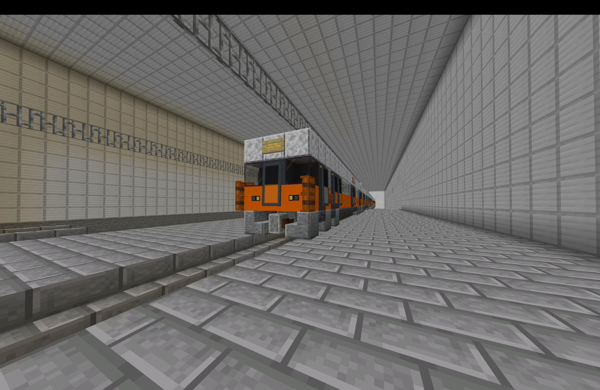
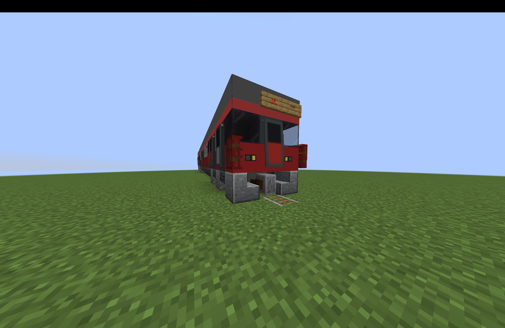
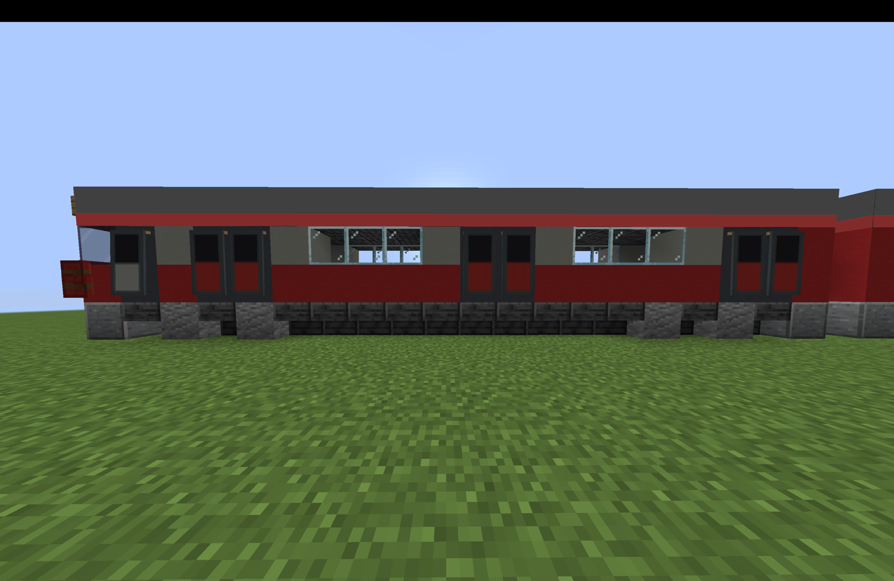
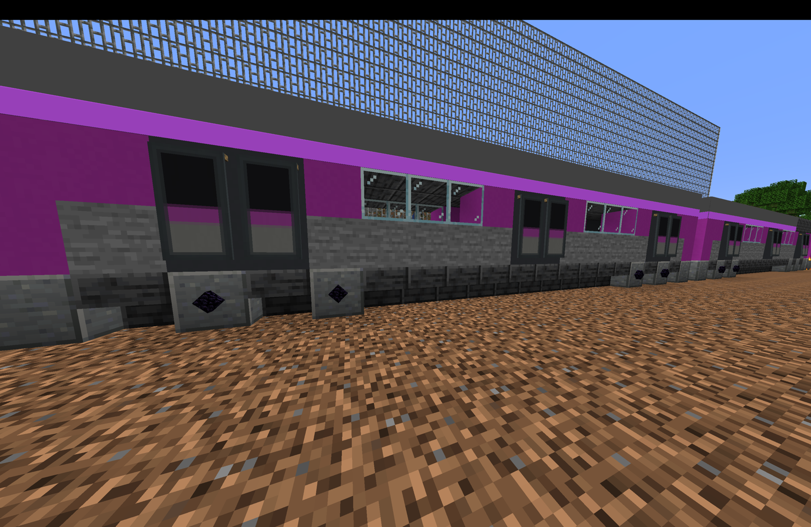
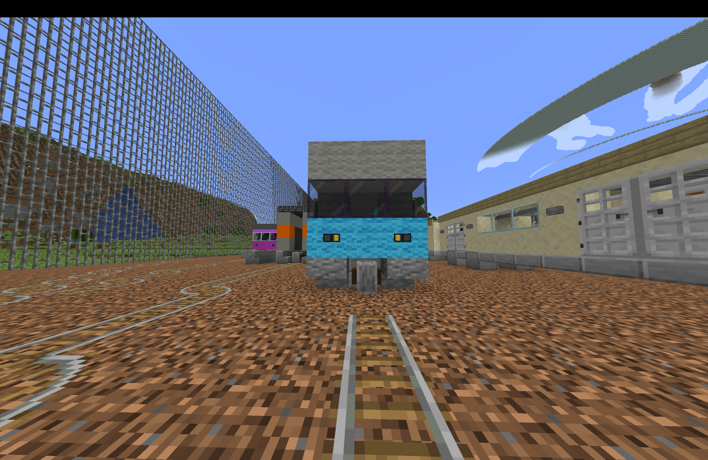
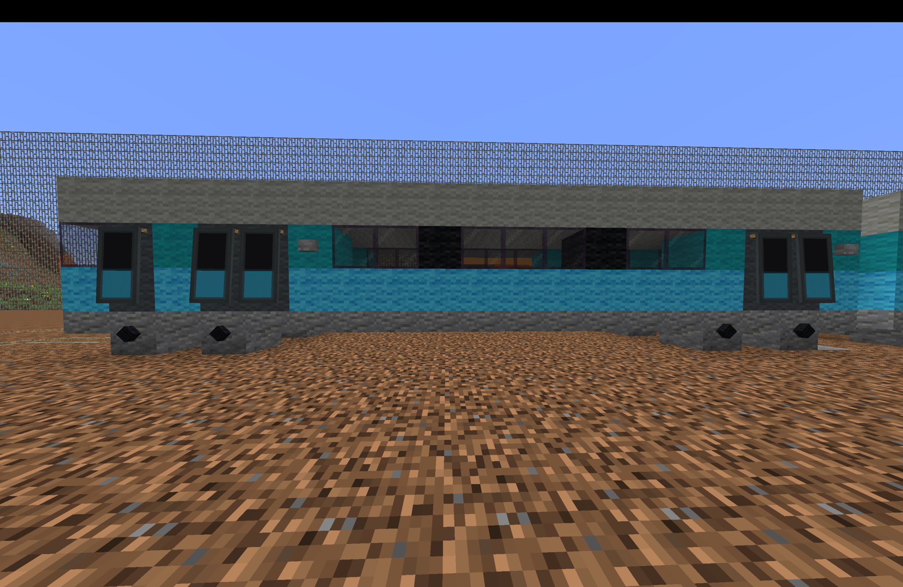
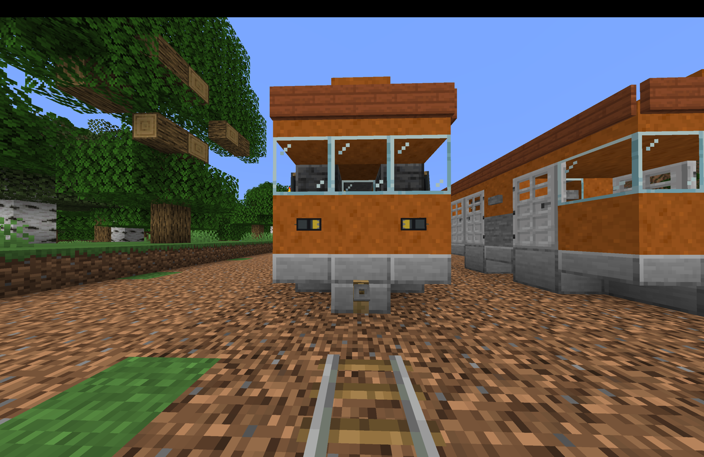
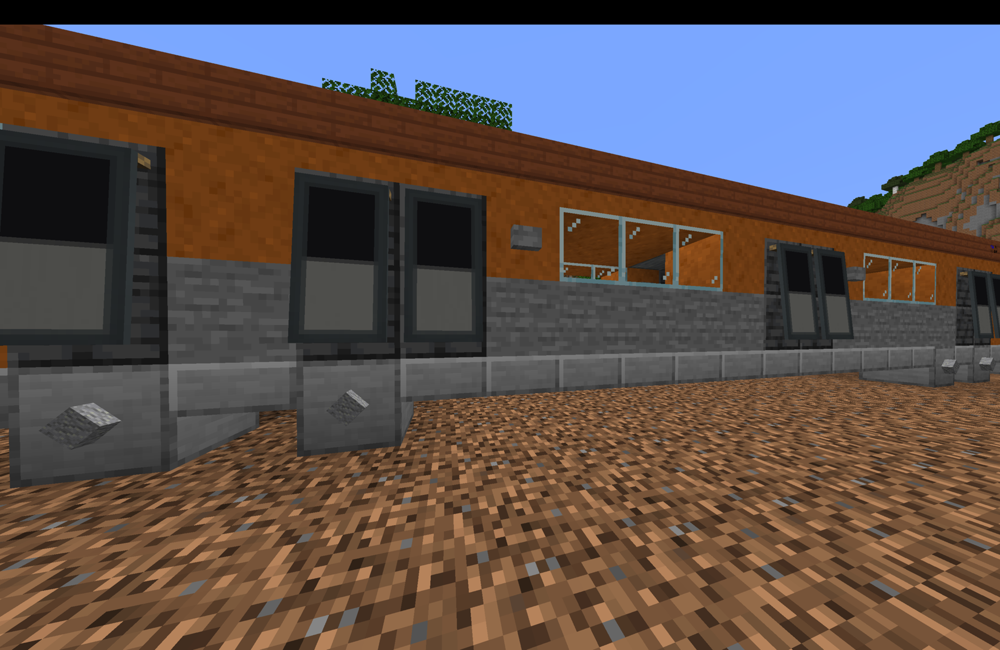
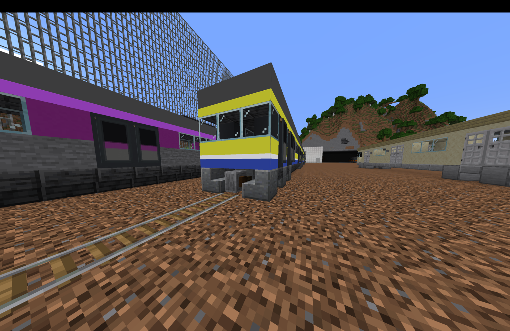
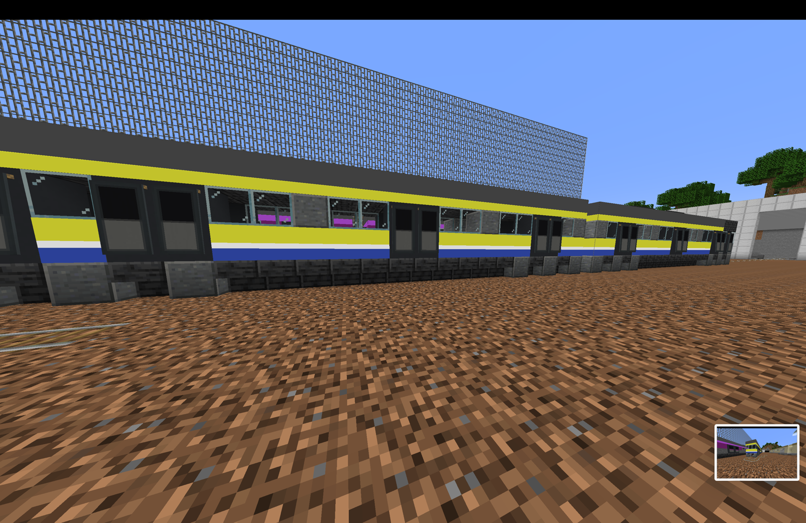

このページでは、東北鉄道について解説します。

<b>目次</b>

- [運行情報](#content_1)
- [東北鉄道とは？](#content_2)
- [路線図](#content_3)
- [東北鉄道が保有する鉄道路線](#content_4)
  - [富山本線](#content_4_1)
    - [路線データ](#content_4_1_1)
    - [設備・停車場](#content_4_1_2)
    - [種別](#content_4_1_3)
    - [種別毎の停車駅](#content_4_1_4)
    - [路線概要](#content_4_1_5)
  - [富山環状線](#content_4_2)
    - [設備・停車場](#content_4_2_6)
    - [種別](#content_4_2_7)
    - [種別毎の停車駅](#content_4_2_8)
    - [路線概要](#content_4_2_9)
  - [津山線](#content_4_3)
    - [路線データ](#content_4_3_10)
    - [設備・停車場](#content_4_3_11)
    - [種別](#content_4_3_12)
    - [種別毎の停車駅](#content_4_3_13)
    - [路線概要](#content_4_3_14)
  - [雲丹津線](#content_4_4)
    - [路線データ](#content_4_4_15)
    - [設備・停車場](#content_4_4_16)
    - [種別](#content_4_4_17)
    - [種別毎の停車駅](#content_4_4_18)
    - [路線概要](#content_4_4_19)
  - [芝浦線](#content_4_5)
    - [路線データ](#content_4_5_20)
    - [設備・停車場](#content_4_5_21)
    - [種別](#content_4_5_22)
    - [種別毎の停車駅](#content_4_5_23)
    - [路線概要](#content_4_5_24)
  - [東北空港線](#content_4_6)
    - [路線データ](#content_4_6_25)
    - [設備・停車場](#content_4_6_26)
    - [種別](#content_4_6_27)
    - [種別毎の停車駅](#content_4_6_28)
    - [路線概要](#content_4_6_29)
  - [さいべりあ本線](#content_4_7)
    - [路線データ](#content_4_7_30)
    - [設備・停車場](#content_4_7_31)
    - [種別](#content_4_7_32)
    - [種別毎の停車駅](#content_4_7_33)
    - [路線概要](#content_4_7_34)
  - [松牛線](#content_4_8)
    - [路線データ](#content_4_8_35)
    - [設備・停車場](#content_4_8_36)
    - [種別](#content_4_8_37)
    - [路線概要](#content_4_8_38)
- [東北鉄道が保有する鉄道車両(運用中)](#content_5)
  - [T400系](#content_5_9)
    - [車両データ](#content_5_9_39)
    - [概要](#content_5_9_40)
  - [T120系](#content_5_10)
    - [車両データ](#content_5_10_41)
    - [概要](#content_5_10_42)
    - [車両の写真](#content_5_10_43)
    - [使用路線](#content_5_10_44)
  - [T130系](#content_5_11)
    - [車両データ](#content_5_11_45)
    - [車両の写真](#content_5_11_46)
    - [使用路線](#content_5_11_47)
  - [T110系](#content_5_12)
    - [車両データ設計](#content_5_12_48)
    - [概要](#content_5_12_49)
    - [車両の写真](#content_5_12_50)
    - [使用路線](#content_5_12_51)
  - [キハT10系](#content_5_13)
    - [車両データ](#content_5_13_52)
    - [車両の写真](#content_5_13_53)
    - [使用路線](#content_5_13_54)
  - [GV-T100系](#content_5_14)
    - [車両データ設計](#content_5_14_55)
    - [概要](#content_5_14_56)
    - [車両の写真](#content_5_14_57)
    - [使用路線](#content_5_14_58)
- [東北鉄道が保有する鉄道車両(廃車済)](#content_6)
  - [T100系](#content_6_15)
    - [車両データ](#content_6_15_59)
    - [概要](#content_6_15_60)
    - [車両の写真](#content_6_15_61)
    - [使用路線](#content_6_15_62)
  - [GV-T301系](#content_6_16)
    - [車両データ](#content_6_16_63)
    - [車両の写真](#content_6_16_64)
    - [使用路線](#content_6_16_65)
- [その他](#content_7)

## 運行情報

<b>現在、運転見合わせなどの情報は入っておりません。</b>

## 東北鉄道とは？

主に東北県各地域へのアクセスを向上するために建設された鉄道。  
富山本線、富山環状線、津山線、芝浦線、東北空港線、さいべりあ本線、雲丹津線、その他多くの路線があり、鯖最大級の路線数を誇る。  
最近では貨物輸送もしている。

## 路線図

準備中...

## 東北鉄道が保有する鉄道路線

### 富山本線

#### 路線データ

| 起点 | 富山駅(TH-01) |
| --- | --- |
| 終点 | 旗須駅(TH-27) |
| 営業最高速度 | 130km/h |
| 保安装置 | ATACS(新富山駅-籟流駅間 緩行線)　ATS-P(富山駅-籟流駅間 快速線,籟流駅-旗須間) |
| 軌間 | 1067mm |
| 路線カラー | オレンジ |
| 開業 | 2022年4月20日 |

#### 設備・停車場

| 施設名 | ナンバリング | 接続路線 | 備考 |  |
| --- | --- | --- | --- | --- |
| 富山駅 | TH-01 | 東北鉄道津山線,芝浦線,富山環状線,なめ急麗谷線,小宮電鉄線 |  |  |
| 新富山駅[車両製作所前] | TH-02 |  |  |  |
| 新富山車両製作所 |  |  |  |  |
| 山間駅 | TH-03 |  |  |  |
| 磯原駅 | TH-04 | 富山環状線 |  |  |
| 竹林駅 | TH-05 |  |  |  |
| 豊平駅 | TH-06 | 地下鉄線 |  |  |
| 東鉄札幌駅 | TH-07 | しゃけでん線,平原鉄道森本線,赤城急行電鉄彩都本線,さこぴー鉄道線 |  |  |
| 青水巨大穴駅 | TH-08 |  |  |  |
| 石北駅(文化会館前) | TH-09 | 赤城急行電鉄 |  |  |
| 新岡町駅 | TH-10 | 南呂電鉄線 | 工事中... |  |
| 日吉町駅 | TH-11 | しゃけでん市内線 |  |  |
| スポーン南駅 | TH-12 | 寿司鉄道線,TR線,しゃけでん線 |  |  |
| 武蔵西大寺駅 | TH-13 | MR線,TR線 |  |  |
| 史の草駅 | TH-14 | TR線 |  |  |
| 籟流駅 | TH-15 | なめ急西鯖南北線(一部相互直通運転),松地端線,TNTN寒州線 |  |  |
| 北島内駅 | TH-16 |  |  |  |
| 水口駅 | TH-17 |  |  |  |
| 長浜駅 | TH-18 |  |  |  |
| 天王洲駅 | TH-19 |  |  |  |
| 新押上口駅 | TH-20 |  |  |  |
| 押上駅 | TH-21 | ずんだもち鉄道ずんだスカイツリーライン |  |  |
| 東鉄南千住駅 | TH-22 | ずんだもち鉄道ずんだスカイツリーライン |  |  |
| 筒川駅 |  |  |  |  |
| 田所神代駅 |  |  |  |  |
| 清水川駅 |  |  |  |  |
| 東旗須駅 |  |  |  |  |
| 旗須駅 | TH-27 | 磯崎電鉄大陸大橋線(特急列車のみ相互直通運転) |  |  |
| 水戸駅(臨) | TH-91 |  | 石北駅から分岐。TNTN直通路線のみ停車。 |  |
| 岡町駅 | TH-92 | TNTN,高槻電鉄,赤城急行電鉄 | **スポーン東方面のTNTN岡町線へ直通** |  |

#### 種別

- <b>普通</b>
- <b>快速</b>
- <b>快速つばめ</b>
- <b>快速みどりうみ</b>
- <b>富山快速</b>
- <b>特急おおわし</b>
- <b>特急かささぎ</b>

#### 種別毎の停車駅

| 施設名 | <b>普通</b> | <b>快速</b> | <b>快速つばめ</b> | <b>快速みどりうみ</b> | <b>富山快速</b> | <b>特急</b> |
| --- | --- | --- | --- | --- | --- | --- |
| 富山駅 | ○ | ○ | ○ | ○ | ○ | ○ |
| 新富山駅 | ○ | ○ | ○ | ○ | ○ | △ |
| 山間駅 | ○ |  |  |  |  |  |
| 磯原駅 | ○ | ○ | ○ | ○ |  |  |
| 竹林駅 | ○ |  |  |  |  |  |
| 豊平駅 | ○ |  |  |  |  |  |
| 札幌駅 | ○ | ○ | ○ | ○ | ○ | △ |
| 青水巨大穴駅 | ○ |  |  |  |  |  |
| 石北文化会館前駅 | ○ | ○ | ○ | ○ | ○ |  |
| 新岡町駅 | ○ |  |  |  |  |  |
| 日吉町駅 | ○ | ○ | ○ | ○ |  |  |
| スポーン南駅 | ○ | ○ | ○ | ○ | ○ | △ |
| 武蔵西大寺駅 | ○ |  |  |  |  |  |
| 史の草駅 | ○ |  |  |  |  |  |
| 籟流駅 | ○ | ○ | ○ | ○ | ○ | ○ |
| 北島内駅 | ○ | - | - | - | ○ |  |
| 水口駅 | ○ | - | - | - | ○ |  |
| 長浜駅 | ○ | - | - | - | ○ |  |
| 天王洲駅 | ○ | - | - | - | ○ |  |
| 新押上口駅 | ○ | - | - | - | ○ |  |
| 押上駅 | ○ | - | - | - | ○ | ○ |
| 東鉄南千住駅 | ○ | - | - | - | ○ |  |
| 筒川駅 | ○ | - | - | - | ○ |  |
| 田所神代駅 | ○ | - | - | - | ○ |  |
| 清水川駅 | ○ | - | - | - | ○ |  |
| 東旗須駅 | ○ | - | - | - | ○ |  |
| 旗須駅 | ○ | - | - | - | ○ | ○ |
| 水戸駅(臨) | ○ | ○ | - | - | - | - |
| 岡町駅 | ○ | ○ | - | - | - | - |

#### 路線概要

元々は札幌 石北 スポーン 籟流などの主要都市と富山のアクセスを良くするために建設された。  
今では旗須駅まで延伸されたり、さいべりあ線への直通運転が行われており、乾燥街やさいべりあなどへのアクセスもしやすい特急も走っている。  
基本的に6両編成で運行されているが、特急や籟流〜押上間は3\~4両編成、TNTNへの直通と籟流〜旗須駅間のみ一部2\~1両編成で運行されている。  
東北鉄道の中で最も需要のある路線であり、特に富山籟流間は東北鉄道の運輸収入の4割を占めている。

### 富山環状線

| 起点 | 富山 |
| --- | --- |
| 終点 | 西富山 |
| 営業最高速度 | 100km/h |
| 路線全長 | 計測中 |
| 保安装置 | ATS-P |
| 軌間 | 1067mm |
| 路線カラー | 赤 |
| 開業日 | 2024年04月20日 |

#### 設備・停車場

| 施設名 | ナンバリング | 接続路線 | 備考 |
| --- | --- | --- | --- |
| 富山駅 | TL-01 | 東北鉄道富山本線 津山線 芝浦線 なめ急麗谷線 小宮電鉄線 |  |
| 駐屯地前 | TL-02 |  | 芝浦線につながる短絡線がある。 |
| 府松温泉 | TL-03 |  |  |
| 北上川 | TL-04 |  |  |
| 磯原 | TL-05 | 富山本線 |  |
| 木ノ本 | TL-06 |  |  |
| 桜ヶ丘 | TL-07 |  |  |
| 西富山 | TL-08 |  | 津山線への短絡線が分岐している。 |

#### 種別

・<b>普通</b>

#### 種別毎の停車駅

<b>普通列車しかないので省略。</b>

#### 路線概要

富山の再開発、拡大した富山市各地へのアクセス向上を目的として貨物線を旅客線化して作られた。  
正式な起点は富山駅、終点は西富山駅となっているが、旅客運行をしている列車はほとんどが環状運転をしている。  
東北鉄道の各路線への短絡線が多くあり、臨時列車がたまに走ったりしている。  
基本、T130系0番代の車両が3両で走っている。

### 津山線

#### 路線データ

| 起点 | 富山駅(TT-01) |
| --- | --- |
| 終点 | 津山駅(TT-09) |
| 営業最高速度 | 100km/h |
| 路線全長 | 計測中 |
| 保安装置 | ATS-P |
| 軌間 | 1067mm |
| 開業日 | 2023年06月24日 |
| 路線カラー | 黄緑 |

#### 設備・停車場

| 施設名 | ナンバリング | 接続路線 | 備考 |
| --- | --- | --- | --- |
| 富山駅 | TT-01 | 富山本線,芝浦線,富山環状線,なめ急麗谷線,小宮電鉄 |  |
| 土呂ノ谷駅 | TT-02 |  | 前一両のみドア開閉可　簡易改札機 |
| 下骨董駅 | TT-03 |  | 簡易改札機 |
| 北骨董駅 | TT-04 |  | 簡易改札機 |
| 草壁駅 | TT-05 | 輪山鉄道線 | 簡易改札機 |
| 川越駅 | TT-06 | 東北鉄道雲丹津線 |  |
| 東津山 | TT-07 |  | 前一両のみドア開閉可　簡易改札機 |
| 東鉄津山駅 | TT-08 | 平原鉄道森本線 |  |

#### 種別

- <b>普通</b>
- <b>津山快速</b>
- <b>区間快速</b>
- <b>特別快速</b>

#### 種別毎の停車駅

| 施設名 | ナンバリング | <b>普通</b> | 津山快速・区間快速 | <b>特別快速</b> |
| --- | --- | --- | --- | --- |
| 富山駅 | TT-01 | ○ | ○ | ○ |
| 土呂ノ谷駅 | TT-02 | ○ |  |  |
| 下骨董駅 | TT-03 | ○ | ○ |  |
| 北骨董駅 | TT-04 | ○ |  |  |
| 草壁駅 | TT-05 | ○ | ○ |  |
| 川越駅 | TT-06 | ○ | ○ | ○ |
| 東津山駅 | TT-07 | ○ |  |  |
| 津山駅 | TT-08 | ○ | ○ | ○ |

#### 路線概要

富山と津山のアクセスを良くするために建設された。  
建設前は富山→札幌→緑町と大回りをしないといけなかったが、建設後は1本で行けるようになった。  
朝と夕方には雲丹津線に直通する、区間快速および普通列車が運行される。

### 雲丹津線

#### 路線データ

| 起点 | 川越 |
| --- | --- |
| 終点 | 運湖 |
| 営業最高速度 | 85km/h |
| 路線全長 | 計測中 |
| 保安装置 | ATS-P |
| 軌間 | 1067mm |
| 路線カラー | 黄色 |
| 開業日 | 2024年04月20日 |

#### 設備・停車場

| 施設名 | ナンバリング | 接続路線 | 備考 |
| --- | --- | --- | --- |
| 川越駅 | TU-01 | 津山線 |  |
| 谷河原駅 | TU-02 |  | 東呂地方鉄道 |
| 雲丹津駅 | TU-03 | 小宮電鉄線,なめ急麗谷線 |  |
| 森ノ口駅 | TU-04 |  |  |
| 南小谷駅 | TU-05 |  |  |
| 大岩駅 |  |  |  |
| 中土駅 |  |  |  |
| 運湖駅 |  | RR秘境線(RR中海まで直通運転) |  |

#### 種別

・普通

#### 種別毎の停車駅

| 施設名 | ナンバリング | 普通 | 快速おたり |
| --- | --- | --- | --- |
| 川越駅 | TU-01 | ○ | ○ |
| 谷河原駅 | TU-02 | ○ |  |
| 雲丹津駅 | TU-03 | ○ | ○ |
| 森ノ口駅 | TU-04 | △ |  |
| 南小谷駅 | TU-05 | ○ | ○ |
| 大岩駅 |  | △ |  |
| 中土駅 |  | △ |  |
| 運湖駅 |  | ○ | ○ |

#### 路線概要

意外とアクセスの悪かった川越〜雲丹津の輸送を担っている。年中通してドアはボタン式。  
普通列車の全てがワンマン運転となっているが、朝夕の時間帯に運行される区間快速は全てツーマン運転になっている。  
カーブが多く、線形があまり良くないので、最高速度はあまり上げられていない。  
基本、川越〜南小谷ではT120系3000番台が、川越〜運湖はキハT10系が使われている。  
利用者の低迷による鉄道の廃止、バス転換への計画がなされたが、平行道路が発達していないため、凍結された。

### 芝浦線

#### 路線データ

| 起点 | 富山 |
| --- | --- |
| 終点 | 彼岸島 |
| 営業最高速度 | 120km/h |
| 路線全長 | 計測中 |
| 保安装置 | ATACS(富山駅ー芝浦港駅間) ATS-P(芝浦港-彼岸島間) |
| 軌間 | 1067mm |
| 路線カラー | スカイブルー |
| 開業日 | 2023年08月01日 |

#### 設備・停車場

| 施設名 | ナンバリング | 接続路線 | 備考 |
| --- | --- | --- | --- |
| 富山駅 | TS-01 | 東北鉄道富山本線,津山線,富山環状線,小宮電鉄,なめ急麗谷線 |  |
| 東富山駅 | TS-02 |  |  |
| 陸前小宮駅 | TS-03 | RR秘境線 |  |
| ？？？駅 |  |  | 新駅建設構想あり |
| 坂上駅 | TS-04 | RR秘境線 |  |
| 杜の台駅 | TS-05 |  |  |
| 仁賀保駅 | TS-06 |  |  |
| 芝浦港駅 | TS-07 | 東北空港線,RR秘境線 |  |
| 芝浦駅 | TS-08 | RR秘境線 |  |
| 彼岸島駅 | TS-09 | NKRわんがん鉄道海岸線 |  |

#### 種別

- <b>普通(各駅停車)</b>
- <b>エアポート快速</b>
- <b>✈︎空港特快</b>

#### 種別毎の停車駅

| 施設名 | ナンバリング | <b>普通(各駅停車)</b> | <b>✈︎空港快速</b> | ✈︎空港特快 |
| --- | --- | --- | --- | --- |
| 富山駅 | TS-01 | ○ | ○ | ○ |
| 東富山駅 | TS-02 | ○ |  |  |
| 川村駅 | TS-03 | ○ |  |  |
| 坂上駅 | TS-04 | ○ |  |  |
| 杜の台駅 | TS-05 | ○ | ○ |  |
| 仁賀保駅 | TS-06 | ○ |  |  |
| 芝浦港駅 | TS-07 | ○ | △ |  |
| 芝浦駅 | TS-08 | ○ | - | - |
| 彼岸島駅 | TS-09 | ○ | - | - |

#### 路線概要

元々は芝浦港への貨物輸送を目的に建設されたが、現在は沿線の開発等により、旅客輸送がメインになっている。  
また、ラッシュ時の混雑が鯖内でトップクラスに酷く、陸前小宮→東富山間で乗車率180%を記録した。(2026年)  
４両編成化や運行本数増加をして混雑率の緩和を図っている。  
2024年の6月30日までは杜の台信号所から山形支線が分岐していたが、(旅客案内上は坂上駅からの分岐)  
同年7月1日に廃線になり、バス転換がされた。なお、廃止になった線路は小宮電鉄に譲渡されている。

### 東北空港線

#### 路線データ

| 起点 | 芝浦港 |
| --- | --- |
| 終点 | 東北空港 |
| 営業最高速度 | 80km/h |
| 路線全長 | 計測中 |
| 保安装置 | ATS-P(芝浦港-東北空港間) |
| 軌間 | 1067mm |
| 路線カラー | 黄色+スカイブルー |
| 開業日 | 2023年10月07日 |

#### 設備・停車場

| 施設名 | ナンバリング | 接続路線 | 備考 |
| --- | --- | --- | --- |
| 芝浦港駅 | TS-07 | 東北鉄道芝浦線 |  |
| 西前海岸駅 | TS-71 |  |  |
| 西前市駅 | TS-72 |  |  |
| 東北空港駅 | TS-73 |  | なめ急線との直通運転を予定 |

#### 種別

- <b>普通(各駅停車)</b>
- <b>✈︎空港快速</b>
- <b>✈︎空港特快</b>

#### 種別毎の停車駅

| 駅名 | ナンバリング | <b>普通(各駅停車)</b> | <b>✈︎空港快速</b> | <b>✈︎空港特快</b> |
| --- | --- | --- | --- | --- |
| 芝浦港 | TS-07 | ○ | △ |  |
| 西前海岸 | TS-71 | ○ |  |  |
| 西前市 | TS-72 | ○ | ○ | ○ |
| 東北空港 | TS-73 | ○ | ○ | ○ |

#### 路線概要

東北空港へのアクセスのために建設された。  
西前の再開発に伴い、線路が地上に移される計画がある。

### さいべりあ本線

#### 路線データ

| 起点 | 籟流 |
| --- | --- |
| 終点 | さいべりあ(延伸計画あり) |
| 営業最高速度 | 130km/h |
| 路線全長 | 計測中 |
| 保安装置 | ATS-P |
| 軌間 | 1067mm |
| 路線カラー | ブルー(さいべりあ地区色) |
| 開業日 | 2023年06月24日 |

#### 設備・停車場

| 施設名 | ナンバリング | 接続路線 | 備考 |
| --- | --- | --- | --- |
| 籟流駅 | TI-01 | 東北鉄道富山本線(相互直通運転),なめ急西鯖南北線(相互直通運転),TNTN寒州線 |  |
| 南籟流駅 | TI-02 |  |  |
| 雪の境駅 | TI-03 |  |  |
| 寒州駅 | TI-04 | TNTN線 |  |
| 寒海海底トンネル |  |  |  |
| 土樽 | TI-05 |  |  |
| 八日市 | TI-06 |  |  |
| 二日市 | TI-07 |  |  |
| さいべりあ | TI-08 | 東北鉄道松牛線,なめ急峡江線 | 暫定的な終着駅 |

#### 種別

・普通　・<b>特急おおわし・特急おおたか・特急南越</b>

#### 種別毎の停車駅

| 施設名 | ナンバリング | 普通 | <b>富山快速</b> | <b>特急</b> |
| --- | --- | --- | --- | --- |
| 籟流駅 | TI-01 | ○ | ○ | ○ |
| 南籟流駅 | TI-02 | ○ |  |  |
| 雪の境駅 | TI-03 | ○ |  |  |
| 寒州駅 | TI-04 | ○ | ○ | △ |
| 土樽 | TI-05 | ○ | ○ |  |
| 八日市 | TI-06 | ○ | ○ |  |
| 二日市 | TI-07 | ○ | ○ |  |
| さいべりあ | TI-08 | ○ | ○ | ○ |

#### 路線概要

全区間でT510系0番台、特急列車T600系を主に使用しており、基本2\~4両で運行している。また、籟流駅-寒州駅間、土樽駅-さいべりあ駅間ではワンマン運転も行われている。  
さいべりあへのアクセスと周辺地域の活性化を目的に建設された。豪雪地域の為、工事が予定よりも遅れていた。

### 松牛線

#### 路線データ

| 起点 | さいべりあ |
| --- | --- |
| 終点 | 開發通り |
| 営業最高速度 | 120km/h |
| 路線全長 | 計測中 |
| 保安装置 | ATS-P |
| 軌間 | 1067mm |
| 路線カラー | ブルー(さいべりあ地区色) |
| 開業日 | 2024年10月13日 |

#### 設備・停車場

| 施設名 | 接続路線 | 説明 |
| --- | --- | --- |
| さいべりあ駅 | 東北鉄道さいべりあ線,なめ急峡江線 |  |
| 横山駅 |  |  |
| 美川町駅 |  |  |
| 松牛口駅 |  |  |
| 松牛駅 |  | 当駅よりTNTN巴里環状線に直通(北巴里駅まで) |

#### 種別

・普通

#### 路線概要

さいべりあ〜松牛間の都市間輸送を目的として建設された。  
松牛 開發通り間のみ複線であり、それ以外の区間は全て単線である。快速列車が運行される予定。

## 東北鉄道が保有する鉄道車両(運用中)

~~電車が好きで作ってるんでこんなの自己満だろ~~

### T400系

#### 車両データ

| 設計最高速度 | 130km/h |
| --- | --- |
| 営業最高速度 | 130km/h |
| 起動加速度 | 2.5km/h/s |
| 減速度(乗用) | 4.5km/h/s |
| 減速度(非常) | 5.3km/h/s |
| 制御方式 | 東北工業フルSic-VVVF |

#### 概要

東北鉄道が独自に作成した近郊型の交直流車である。富山本線の延伸に合わせて作成された。制作においては、T100系の試験車、T120系より得られたデータを多く活用している。  
座席は全てセミクロスシートになっており、トイレがついてあったり長距離利用に適した車内になっている。  
0番台は富山総合車両センター所属、1000番台は押上車両基地所属の車両である。

0番台:富山本線 さいべりあ線  
1000番台：富山本線 さいべりあ線 外環状線(清水川駅-寒州駅間)

### T120系

#### 車両データ

| 設計最高速度 | 0番台130km/h 100番台以降120km/h |
| --- | --- |
| 起動加速度 | 300番台 3.3km/h/s 300番台以外 2.5km/h/s |
| 減速度 | 5km/h/s |
| 制御方式 | 東北工業IGBT-VVVF |

#### 概要

東北鉄道が独自に作成した通勤型車両であり、直流型車両である。T100系では通勤時には不向きだったため、通勤時を想定して作成した車両である。  
0番台：主に4両編成(+2両編成)だが、2,4,6,8両の偶数両編成が可能。ドアは4ドアに変更。　車内にはLCDを各ドアの上に二つ設置。  
一部編成には3号車に6ドア車を設置することで通勤ラッシュ時にも乗り降りをスムーズにできるようにした。  
基本、全てロングシートだが、1号車、4号車(運転台のある車両)、5号車、6号車はセミクロスシートである。  
ドア横のボタンは使用できるときにボタンが光るようにすることで分かりやすくした。  
長期移動に備えてトイレを設置。車椅子をご利用の方にも広々と使いやすくした。  
0番台の編成には全て転落防止幌が取り付けられている。  
クハT120-1、サハT120-9以外全車廃車済

1000番台：全て4両固定の編成になっている。2両編成を連結して6両編成にすることもあるが、基本的に平日朝夕のラッシュ限定である。  
全車廃車済

2000番台：主に2両編成。混雑時には連結して4両編成にすることもできる。2両編成の際はワンマン運転ができるように車外カメラが設置されている。  
全車廃車済

3000番台：ドアが3ドアになり、オールロングシートになっている。踏切事故による車両故障、利用者減少による需要低迷のため全編成が3500番台に改造がされている。

3500番台：3000番台とは違い、16Mに短縮された他、1両編成になり、2ドアの車に改造されている。雲丹津線で主に運用されている。

4000番台：0番台の列車を改造して作られた車両で、主に芝浦線で運用されている。2両編成と3両編成固定の編成がある。  
全車廃車済

100番台：IGBT-VVVF、非常用蓄電池を搭載した。20M車になり、ほとんどが6両固定の編成。鯖への負荷を減らすため、透明額縁での塗装からトラップドアでの塗装に変わった。

200番台：20M車になり、ほとんどが２両固定編成だが、一部は3両編成に増車されている。2000番台と同じようにワンマン運転用の側面カメラが取り付けられているほか、ドアボタンも付けられている。

300番台：なめ急線への直通列車の増発に伴い、落成された。他のなめ急線の車両と性能が合わせられている。また、ドアボタンが設置されている。

#### 車両の写真

準備中...

#### 使用路線

100番台:富山本線　200番台:津山線　3500番台:雲丹津線

### T130系

#### 車両データ

| 設計最高速度 | 120km/h |
| --- | --- |
| 起動加速度 | 2.75km/h/s |
| 減速度 | 5km/h/s |
| 制御方式 | 東北工業フルSiC素子VVVFインバータ |

東北鉄道が独自に作成した通勤型車両。主に富山環状線や芝浦線で使われている。  
ホームドアの設置を考慮してドアは3ドア。車内にはLCDを各ドアの上部に設置。  
通勤時を考慮して作られているので、ドアボタンはない。ただし、長時間の停車の時には車両の真ん中のドアのみ開くになっている。

0番台:座席は全てロングシート。鯖で初めて車両の前面に転落防止幌を取り付けた。しかし、連結する運用がないため、撤去が進められている。  
ワンマン運転に対応する改造工事が進んでいるほか、4両編成への増車改造や体質改善工事も随時行われている。

1000番台:座席は全てクロスシート。老朽化が進んでいたGV-T301系を置き換えた。空港アクセスに特化するため、座席定員が増えるクロスシートを採用。  
また他の車両とは違い、荷物スペースを設置している。 落成時からワンマン運転に対応している。  
芝浦線、富山環状線、東北空港線でのホームドア設置に合わせて0番台とほぼ同じ設計になっている。

2000番台:座席は全てロングシート。芝浦線で使われていたT120系を置き換えた。  
芝浦線、富山環状線、東北空港線でのホームドア設置に合わせて0番台とほぼ同じ設計になっている。  
落成時からワンマン運転に対応。4両編成への増車改造が行われている。

#### 車両の写真

0番台  
　

#### 使用路線

0番台:富山環状線  
1000番台:東北空港線 芝浦線  
2000番台:芝浦線

### T110系

#### 車両データ設計

| 設計最高速度 | 130km/h |
| --- | --- |
| 起動加速度 | 2.5km/h/s |
| 減速度 | 5km/h/s |
| 制御方式 | 東北工業界磁チョッパ制御 東北工業IGBT-VVVF 東北工業GTO-VVVF |

#### 概要

東北鉄道が独自に作成したなめ急線直通用の車両。  
東北鉄道で初のIGBT-VVVFを搭載した車両でもある。(一部編成はGTO-VVVFや界磁チョッパ制御)  
東北鉄道の多くの車両長が21M(東北鉄道規格)だが、なめ急線の規格に揃えるため、20Mで、3ドアになっている。  
座席は全てロングシート。　車内の快適な温度を保つためにドアボタンを設置。　1次車にはLEDを千鳥配置に設置。2次車にはLCDを千鳥配置に設置。

#### 車両の写真

#### 使用路線

0番台:富山本線・なめ急線直通線

### キハT10系

#### 車両データ

| 設計最高速度 | 100km/h |
| --- | --- |

\|営業最高速度|100km/h|  
\|平均起動加速度|2.3 km/h/s|  
\|減速度|3km/h/s|

東北鉄道が初めて独自に作成した気動車。電線がない芝浦線での運用を目標に作成された。1\~6両編成が可能。ドアは2ドア。各車両の後ろと前に運賃表を設置。  
座席はオールボックスシート。寒冷地などに備えてドアボタンを設置。　ワンマン運転が可能で、車内で運賃の精算などもできる。

0番台： 2両編成5編成,1両編成2編成が1000番台に改造され、それ以外の編成は富山本線むけに改造工事がされた。また、T120系に置き換えられ、芝浦線での運用から撤退。

1000番台：雲丹津北線の開業より運行されている。また、2両編成の列車はクロスシートに改造され、快速おたりの運行をしている。

#### 車両の写真

#### 使用路線

0番台:富山本線　芝浦線(定期運用撤退)  
1000番台：雲丹津線

### GV-T100系

#### 車両データ設計

設計最高速度 100km/h  
起動加速度　2.3km/h/s  
減速度　3.5km/h/s

制御方式 コンバータ+IGBT-VVVFインバータ制御

#### 概要

東北鉄道が独自に作成したディーゼルエンジンの動力で発電した電力で主電動機を駆動する、いわゆるディーゼル・エレクトリック方式の電気式気動車。  
1両編成と2両編成があり、組み合わせて1\~6両編成が組めるようになっている。座席はボックスシートとロングシートがある。  
寒冷地に備えてドアボタンを設置。ワンマン運転が可能で、車内で運賃の清算などができるようになっている。

#### 車両の写真

準備中

#### 使用路線

0番台:富山本線 外環状線(清水川駅-寒州駅間)

## 東北鉄道が保有する鉄道車両(廃車済)

### T100系

<b>一部廃車済</b>

#### 車両データ

| 設計最高速度 | 130km/h |
| --- | --- |
| 営業最高速度 | 0,1000番台:100km/h |
| 起動加速度 | 2.5km/h/s |
| 減速度 | 5km/h/s |
| 制御方式 | 東北工業界磁チョッパ制御 東北工業GTO-VVVF |

#### 概要

東北鉄道が初めて独自に作成した近郊型車両。<del>東北鉄道で一番使われている車両でもある。</del>  
2,3,4両の編成が可能。ドアは3ドア。　車内には三色LEDを各ドアの上に一つ設置。  
基本、ロングシートだが、一部車両にはボックスシートがついている。車内の快適な温度を維持するためにドアボタンを設置。500番台のみワンマン運転が可能。  
130km/hの運行が試験走行で可能とわかったが、不具合が多発したため、100km/hに固定されている。

#### 車両の写真

　

#### 使用路線

なし

### GV-T301系

#### 車両データ

| 設計最高速度 | 110km/h |
| --- | --- |
| 営業最高速度 | 100km/h |
| 起動加速度 | 2.5km/h/s |
| 減速度 | 4.5km/h/s |
| 制御方式 | 東北工業IGBT-VVVF 近郊型 |

0番台：東北鉄道が独自に作成した、**空港アクセスを目的**にできた近郊形車両であり、東鉄初の電気を溜めて走る車両である。試験運用も兼ねて比較的路線全長が短い西前線で運用されている。  
2,3,4両編成が可能。ドアは3ドア。通勤型の車両よりもドアの横幅を大きくすることで大きな荷物を持った方にも乗り降りがスムーズになるようにした。　車内には無料のフリーWi-Fiがついているほか、  
スーツケースなど大きな荷物をおけるスペースを全ての車両に設置し、空港アクセスに特化した車両になっている。  
<del>最近は試験走行が終わったので電車に改造されて運行している。</del>  
全車廃車済み

#### 車両の写真

#### 使用路線

0番台:東北空港線 芝浦線(エアポート快速のみ)

## その他

こちらも併せてどうぞ。  
東北鉄道の裏設定があったりなかったりするドキュメント  
[東鉄裏設定](https://docs.google.com/document/d/1jdfjlALVemLgidQ3QtcrZbQ0tCoKM032Zc0702TBcfk/edit)
