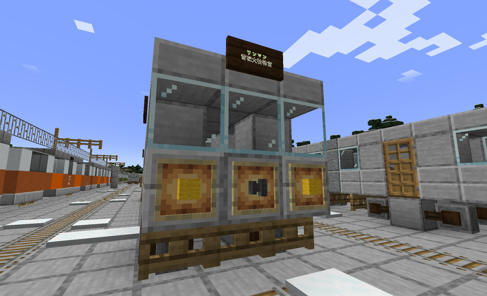
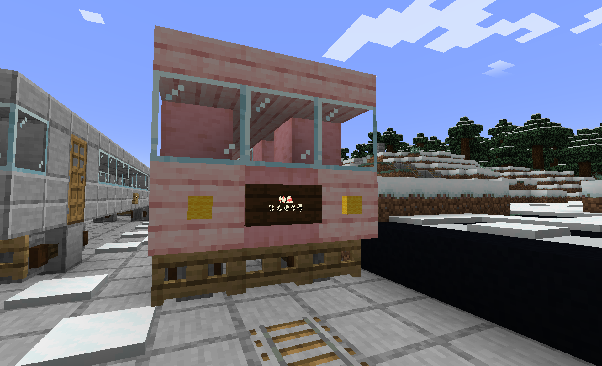
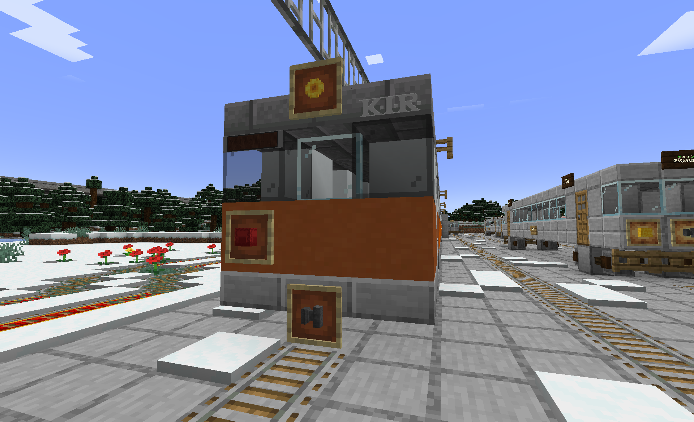

## 注意

このページにはyumaの妄想がけっこうあります。ご注意ください。

## 南戸電鉄（なんとでんてつ）

南戸電鉄とは、いたって普通（でもどこかがおかしい）の地方私鉄である。  
線路状況がやばい。（例として、氷の上を直接わたる<del>、直角カーブ</del>など）このため現在改良を進めている。

### 運休情報

先ほど運転見合わせになっていた参宮線、および戸新内線の一部での運転を再開しました。

### 駅一覧

〇:停車 △:一部停車

#### 南戸線

| 駅名 | 快速 | 快急 | 特急 | 所在地 | 乗換路線 | 参考 |
| --- | --- | --- | --- | --- | --- | --- |
| 戸鳴 | 〇 | 〇 | 〇 | 雪花県戸鳴村 | 戸鳴環状線、雪花モノレール |  |
| 戸鳴新町 | 通過 | 通過 | 通過 | 雪花県戸鳴村 |  |  |
| 戸鳴高校前 | 〇 | 通過 | 通過 | 雪花県戸鳴村 |  | 高校前とか言いながら高校は~~ない~~ある。 |
| ~~中戸新内~~ | 通過 | 通過 | 通過 | 雪花県雪花市 |  | 2026/1/24に廃止。 |
| 戸新内 | 〇 | 〇 | △ | 雪花県雪花市 |  | 駅前には通路と戸新内線ホームしかない。 |
| 南村中 | 〇 | 〇 | 〇 | 雪花県南村 | 雪花モノレール |  |

#### 参宮線・大社線・未来線

| 駅名 | 快速 | 快急 | 特急 | 所在地 | 乗換路線 | 参考 |
| --- | --- | --- | --- | --- | --- | --- |
| 南村中 | 〇 | 〇 | 〇 | 雪花県南村 | 雪花モノレール |  |
| 大社西 | 通過 | 通過 | 通過 | 雪花県南村 |  |  |
| 未来 | 〇 | 〇 | 〇 | 雪花県未来市 |  | 駅前に何もない。 |

#### 戸新内線

| 駅名 | 所在地 | 乗換路線 | 参考 |
| --- | --- | --- | --- |
| 大社西 | 雪花県南村 | 参宮線 |  |
| 小学校前 | 雪花県雪花市 |  |  |
| 湯場消・校門前 | 雪花県雪花市 | 雪山線 |  |
| 空港南 | 雪花県雪花市 |  |  |
| 空港裏口 | 雪花県雪花市 |  |  |
| 新花海 | 雪花県雪花市 |  |  |
| 本町 | 雪花県雪花市 |  |  |
| 劇場前 | 雪花県雪花市 |  | スイッチバック駅 |
| 住宅裏 | 雪花県雪花市 |  | 路線の中で唯一の交換駅 |
| 戸新内 | 雪花県雪花市 | 南戸線 |  |

#### 雪山線

| 駅名 | 所在地 | 乗換路線 | 参考 |
| --- | --- | --- | --- |
| 湯場消・校門前 | 雪花県雪花市 |  |  |
| 雪山 | 雪山市 |  |  |

#### 花海線

<table>
<tr><td>駅名</td><td>所在地</td><td>乗換路線</td><td>参考</td></tr>
<tr><td>新花海</td><td>雪花県雪花市</td><td></td><td></td></tr>
<tr><td>南鉄花海</td><td>雪花県雪花市</td><td></td><td></td></tr>
<tr><td>森久保新町</td><td>雪花県雪花市</td><td></td><td></td></tr>
<tr><td colspan="5">雪花市電北部系統に直通</td></tr>
</table>

#### 新参宮線（工事中）

| 駅名 | 所在地 | 乗換路線 | 参考 |
| --- | --- | --- | --- |
| 未来 | 雪花県未来市 | 参宮線 |  |
| 新大社西（仮称） | 雪花県南村 |  |  |
| 雪花口（仮称） | 雪花県雪花市 |  | 現状完成しているのはここまで |
| 新南村中（仮称） | 雪花県南村 |  |  |

#### 南石谷線

| 駅名 | 所在地 | 乗換路線 | 参考 |
| --- | --- | --- | --- |
| 南村中 | 雪花県南村 | 南戸線・参宮線・新参宮線 |  |
| 石谷 | 雪花県南石谷村 |  |  |
| 南石谷 | 雪花県南石谷村 | 石谷中央線・氷南線 |  |

#### 石谷中央線

| 駅名 | 所在地 | 乗換路線 | 参考 |
| --- | --- | --- | --- |
| 南石谷 | 雪花県南石谷村 | 南石谷線・氷南線 |  |
| 新石谷 | 雪花県南石谷村 |  |  |
| 石谷中央 | 雪花県南石谷村 |  |  |

#### 氷南線

| 駅名 | 所在地 | 乗換路線 | 参考 |
| --- | --- | --- | --- |
| 南石谷 | 雪花県南石谷村 | 南石谷線・石谷中央線 |  |
| 氷南 | 雪花県氷南村 |  |  |

#### 戸鳴環状線

| 駅名 | 所在地 | 乗換路線 | 参考 |
| --- | --- | --- | --- |
| 戸鳴 | 雪花県戸鳴村 | 南戸線、雪花モノレール |  |
| 戸西 | 雪花県戸鳴村 |  | 現在休止中 |
| 手真利 | 雪花県戸鳴村 |  |  |
| 戸鳴 | 雪花県戸鳴村 | 南戸線、雪花モノレール |  |

車両一覧

#### 3000系

  
南戸電鉄最初の車両。主に普通、快速運用につく。  
最初の1・2編成は1993年デビュー。  
営業最大速度90km/h  
一部の編成はフルカラーLED方向幕、半自動ドア搭載という金がない鉄道と思えない豪華仕様。

## 編成一覧

## 1・2編成

<table>
<tr><td>←南村中 戸鳴→</td></tr>
<tr><th>号車</th><td>1</td><td>2</td></tr>
<tr><th>車番</th><td>3000-1</td><td>3000-2</td></tr>
<tr><th>搭載機器</th><td>ATC・ATS装置・ディーゼルエンジン・燃料タンク</td><td>ATC・ATS装置・ディーゼルエンジン・燃料タンク</td></tr>
<tr><th>参考</th><td colspan="2">1993年デビュー、旧型LED搭載、基本車掌乗務（ワンマン化改造予定）</td></tr>
</table>

## 3編成

<table>
<tr><td>←南村中 戸鳴→</td></tr>
<tr><th>号車</th><td>1</td></tr>
<tr><th>車番</th><td>3000-3</td></tr>
<tr><th>搭載機器</th><td>ATC・ATS装置・ディーゼルエンジン・燃料タンク</td></tr>
<tr><th>参考</th><td>1995年デビュー、旧型LED搭載、ワンマン対応</td></tr>
</table>

## 4・6編成

<table>
<tr><td>←南村中 戸鳴→</td></tr>
<tr><th>号車</th><td>1</td><td>2</td></tr>
<tr><th>車番</th><td>3000-4</td><td>3000-6</td></tr>
<tr><th>搭載機器</th><td>ATC・ATS装置・ディーゼルエンジン・燃料タンク</td><td>ATC・ATS装置・ディーゼルエンジン・燃料タンク</td></tr>
<tr><th>参考</th><td colspan="2">2001年デビュー、新型LED搭載、基本車掌乗務（ワンマン化改造予定）</td></tr>
</table>

### 参考

3000-5はJPRに譲渡されたため欠番。

#### 3050系

3000系の検測機能付きバージョン。基本旅客運用に就かない。

## 編成一覧

<table>
<tr><td>←南村中 戸鳴→</td></tr>
<tr><th>号車</th><td>1</td></tr>
<tr><th>車番</th><td>3050-1</td></tr>
<tr><th>搭載機器</th><td>ATC・ATS装置・ディーゼルエンジン・燃料タンク</td></tr>
<tr><th>参考</th><td></td><td>2019年デビュー、旧型LED搭載</td></tr>
</table>

#### 5000系

  
南戸電鉄唯一の特急型車両。主に快急、特急運用につく。（たまに快速にも）  
営業最大速度110km/h

## 編成一覧

## 1・2編成

<table>
<tr><td>←南村中 戸鳴→</td></tr>
<tr><th>号車</th><td>1</td><td>2</td><td>3</td><td>4</td></tr>
<tr><th>車番</th><td>5000-1</td><td>3000-2</td><td>5000-3</td><td>5000-4</td></tr>
<tr><th>搭載機器</th><td>ATC・ATS装置・ディーゼルエンジン・燃料タンク</td><td>ディーゼルエンジン・燃料タンク</td><td>ディーゼルエンジン・燃料タンク</td><td>ATC・ATS装置・ディーゼルエンジン・燃料タンク</td></tr>
<tr><th>参考</th><td colspan="4">2011年デビュー、新型LED搭載、基本車掌乗務（ワンマン化改造予定）</td></tr>
</table>

#### 1000系

  
元・北泉鉄道100系  
2編成が北泉鉄道から譲渡され誕生した形式。<del>現在存在する形式では唯一の電車。</del>主に普通、快速の運用につく。  
営業最大速度100km/h  
最近譲渡時からあった3色LEDを撤去し新型フルカラーLEDにリニューアルした。  
<del>唯一南戸電鉄の車番命名方式に従っていなく北泉鉄道時代の車番をそのまま採用している。</del>2025年度内に改番予定

## 編成一覧

あとで書く

