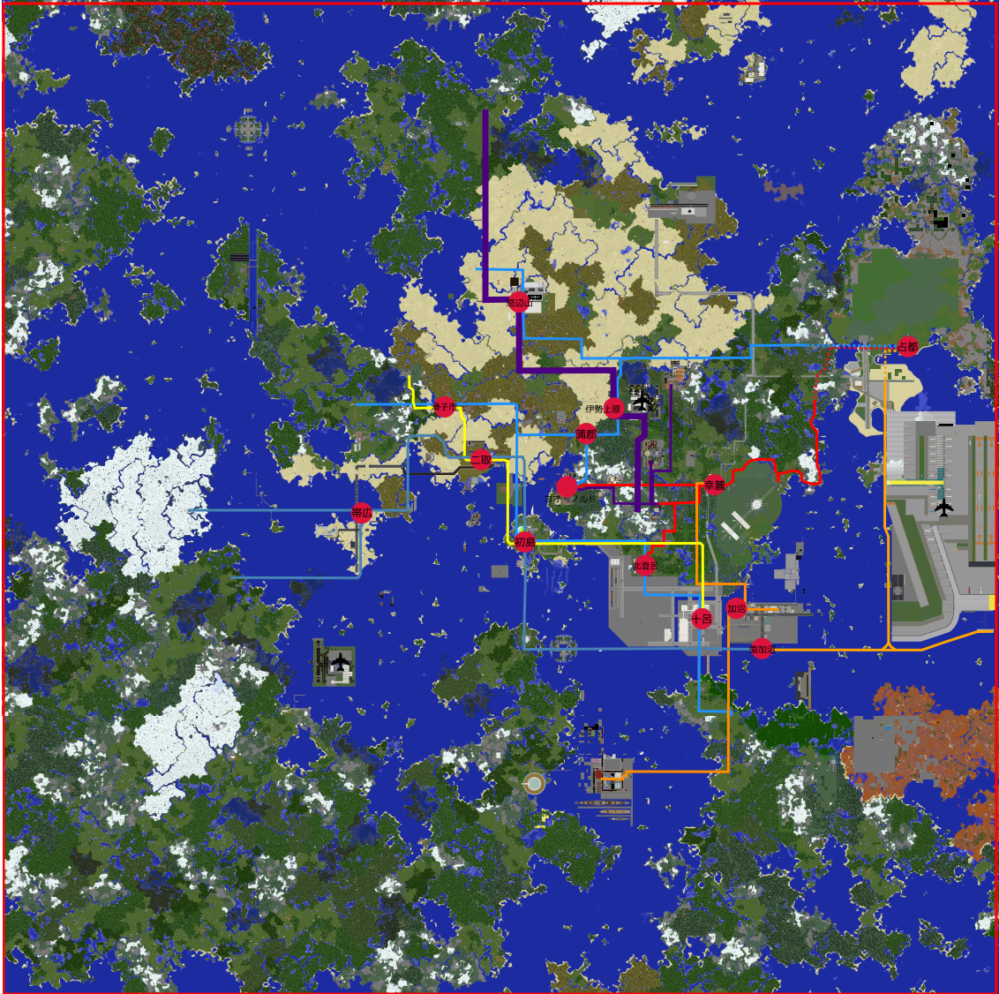

<table>
<tr><td colspan="3" style="background-color:#bbb"></td></tr>
<tr><td style="background-color:#bbb"></td><td style="background-color:#ddd">このページは1.19以前の情報が記載されています。</td><td style="background-color:#bbb"></td></tr>
<tr><td style="background-color:#bbb"></td><td style="background-color:#ddd">最新の情報は→<a href="../03_Transportation/交通.md">交通</a></td><td style="background-color:#bbb"></td></tr>
<tr><td colspan="3" style="background-color:#bbb"></td></tr>
</table>

  
（2018年1月13日現在の路線図）

<table>
<tr><th>事業者名</th><th>MCID</th><th>創業日</th></tr>
<tr><td>nines南海鉄道</td><td>ーーー</td><td>2017/8月下旬ごろ</td></tr>
<tr><td>武蔵電気鉄道</td><td>musashi299</td><td>yaba</td></tr>
<tr><td><a href="https://seesaawiki.jp/toro_r/d/%b9%ac%cf%bc%c5%b4%c6%bb">幸麓鉄道</a></td><td>sakoppi</td><td>2017/8月下旬ごろ</td></tr>
<tr><td>寿司鉄道</td><td>X6Z</td><td>2019/10/23</td></tr>
<tr><td><a href="https://seesaawiki.jp/toro_r/d/%cb%e8%b2%a6%a5%c8%a5%ed%a5%c3%a5%b3%c5%b4%c6%bb">毎王トロッコ鉄道</a></td><td rowspan="2">tokyock1522</td><td>2015/冬頃(⑨)</td></tr>
<tr><td><a href="https://seesaawiki.jp/toro_r/d/%b2%a6%c6%ee%c5%c5%b5%a4%c5%b4%c6%bb">海色交通</a></td><td>2020/4/1</td></tr>
<tr><td><a href="../03_Transportation/敷手鉄道.md">敷手鉄道</a></td><td>lolita_is_god</td><td>20??/??/??</td></tr>
<tr><td>北陸旅客鉄道 / 北陸鉄建事業団(レイス連合総合交通局)</td><td>Laythe_777</td><td>20??/??/??</td></tr>
<tr><td>盤津連邦旅客鉄道</td><td>ikoko125</td><td>20??/??/??</td></tr>
<tr><td>北方鉄道ネットワーク（NTN）/ 北鯖鉄道</td><td>特別民間法人北方開発調整機構（代表：Spalits00, zeamichan）(この鉄道は公営です)</td><td>2019/07/23</td></tr>
<tr><td><a href="../03_Transportation/東占鉄道.md">東占鉄道</a>(とうせんてつどう)</td><td>Seibu_Yellow</td><td>2017/12/14</td></tr>
<tr><td>占都メトロ</td><td>Seibu_Yellow</td><td>2018/3/25</td></tr>
<tr><td>都海鉄道(どはいてつどう) (Duhai Railway)</td><td>Spalits00</td><td>2018/07/28</td></tr>
<tr><td>Airforce High Speed Rail(エアフォース高速鉄道)</td><td>Spalits00</td><td>2018/3/24</td></tr>
<tr><td><a href="../03_Transportation/西鯖鉄道.md">西鯖鉄道</a></td><td>R18Crime</td><td>2018/07/12</td></tr>
<tr><td><a href="https://seesaawiki.jp/toro_r/d/%bd%bd%cf%a4%bb%d4%b1%c4%c3%cf%b2%bc%c5%b4">十呂市営地下鉄</a></td><td>toropon</td><td>2018/??/??</td></tr>
<tr><td>都市間高速鉄道【新幹線】</td><td>Nitori_Choco,Seibu_Yellow</td><td>2018/10/19</td></tr>
<tr><td>南王鉄道(なんおうてつどう)</td><td>kareraisu</td><td>2019/3/2</td></tr>
<tr><td>斗蔭市営地下鉄</td><td>Pemrt</td><td>2019/7/1</td></tr>
<tr><td><a href="https://seesaawiki.jp/toro_r/d/%c2%e7%a5%c8%a5%ed%c5%c5%c5%b4">大トロ電鉄</a></td><td>keita_yamatozi</td><td>2019/9月頃</td></tr>
<tr><td><a href="https://seesaawiki.jp/toro_r/d/%cc%be%ba%a2%c5%b4%c6%bb">名頃鉄道</a></td><td>tanukiti</td><td>2019/10/26</td></tr>
<tr><td><a href="https://seesaawiki.jp/toro_r/d/%b1%ed%c3%ab%bb%d4%b1%c4%c3%cf%b2%bc%c5%b4">燕谷県交通局(燕谷県営地下鉄)</a></td><td>tanukiti</td><td>2019/09/01</td></tr>
<tr><td><a href="https://seesaawiki.jp/toro_r/d/%c3%e6%b1%fb%ef%c4%c6%bb">中央鐡道</a></td><td>Hidezou3</td><td>2019/12/??</td></tr>
<tr><td><a href="https://seesaawiki.jp/toro_r/d/%b3%a4%c9%cd%c5%b4%c6%bb">海浜鉄道</a></td><td>tanukiti</td><td>2020/03/14</td></tr>
<tr><td>神埼鉄道</td><td>Nameko_2020</td><td>2020/3月頃</td></tr>
<tr><td><a href="https://seesaawiki.jp/toro_r/d/%cb%cc%b3%a4%b9%e2%c2%ae%c5%b4%c6%bb">北海高速鉄道</a></td><td>Hidezou3</td><td>2020/3/1?</td></tr>
<tr><td><a href="https://seesaawiki.jp/toro_r/d/%c3%e6%b1%fb%b9%e2%c2%ae%c5%b4%c6%bb">中央高速鉄道</a></td><td>punipuni_</td><td>2019/11/??</td></tr>
<tr><td>丑寅電鉄</td><td>T5ukasah,KL_LV280L1</td><td>2019/7/22</td></tr>
<tr><td>燕谷鉄道</td><td>KL_LV280L1</td><td>2019/11/2</td></tr>
<tr><td><a href="https://seesaawiki.jp/toro_r/d/%c0%d6%be%eb%b5%de%b9%d4%c5%b4%c6%bb">赤城急行鉄道</a></td><td>AKAGI185</td><td>2020/4/25</td></tr>
<tr><td>鵜の浜臨海鉄道</td><td>AKAGI185</td><td>2022/4/3</td></tr>
</table>
