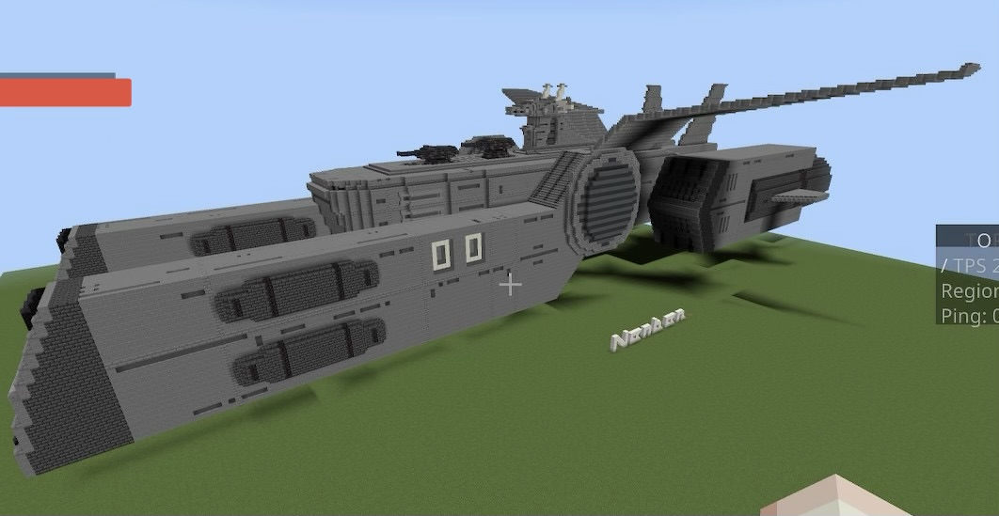

## 我らが偉大なる南蛮軍に栄光あれ‼︎

南蛮軍とはハチミツ総統閣下により設立された南蛮県、山川県の防衛を主な任務とする連合軍である。  
基地には多数の航空機などが配備され、根本から善良なる南蛮市民達がこの混沌とした世界の一角で安全に安心に快適に暮らせる事こそ我らの最大の喜びである。

## 司令部より全南蛮軍関係者に通達

我らは誇り高き南蛮軍人であり、誇り高き南蛮市民でもある。  
今日、遂に我々は宇宙軍の創設を宣言する。  
実にめでたい事である。  
今日という日はめでたい日である。  
それと同時に今日という日は戦いの狼煙が上がった日でもある。  
先日から南蛮、山川周辺の河川にて未確認大型生物が目撃されている。  
諸君らの中でこれを見つけ出し、生捕りするものをつのる。  
諸君らの活躍を大いに期待しているぞ。  
ハチミツ総統閣下

## 構成

### 陸軍

#### プレスリー大隊

本土防衛を主な任務とする大隊。  
戦力 人員312名  
車両数[非公開]

#### ジャクソン大隊

南蛮県、山川県に接近する脅威を事前に排除する事を任務とする大隊。  
戦力　人員271名  
車両数[非公開]

### 空軍

#### ロストハイウェイ大隊

本土防衛を主な任務とする大隊。  
戦力　人員211名  
航空機数[非公開]

#### フラッシュ大隊

前述したジャクソン大隊の行軍を火力支援等で援護する事が主な任務の大隊。  
戦力　人員128名  
航空機数[非公開]

### 宇宙強襲軍

#### 冥王星艦隊

戦力　人員1433名  
保有艦　南蛮級宇宙強襲揚陸艦　2隻  
山川級宇宙巡洋艦　　　4隻  
双木級宇宙戦艦　　　　1隻

## 主力艦艇について

### 南蛮級宇宙強襲揚陸艦

本艦は史上初の南蛮宇宙軍艦艇である。  
全長  
翼長  
武装: 34センチメートル2連装砲2門  
23センチメートル副砲4門  

## 主な指導者達

### ハチミツ総統

南蛮軍最高司令官にして創始者。  
好物は蜂蜜。  
役職は総統ではなく総帥。

### ブライアン・マーキュリー提督

南蛮空軍の発展に尽力した人物であり、ac-130の配備を計画し、実行したのも彼である。

### ΩNA-コンピュータ-079

ΩNA-コンピュータ-079(オメガエヌエーコンピュータナナキュウ)は南蛮軍幹部の補佐として開発された人工知能で、宇宙軍の創設はこれにより進言された。

## 極秘事項

### ［生物兵器創生プロジェクト］

＊注意:これより先の内容の閲覧はセキュリティクリアランスレベル4以上の南蛮軍関係者のみに制限されます。  
権限を持たない者が閲覧した場合、理由の如何に関わらず即刻終了処分が取られます。

### 実験体一号

本実験体は[データ削除済み]と南蛮軍最高司令官により、植物と動物の中間の存在として計画された物です。  
月見草と犬の細胞、いくつかの機械部品から構成されており、体長は122.9cm。  
培養液内での合成、安定的な生存に成功しました。  
しかし、知能はないに等しい上、貧弱で免疫機構を備えていないという特性上、生物兵器としては欠陥品であるとして廃棄処分されました。

### 実験体二号

前述の一号と同じく植物と動物の中間の存在として創造されました。  
蓮子とイノシシの細胞、人工知能を搭載したコンピュータにより構成されており、体長334.0cm。  
培養液内での安定的な生存、免疫力の獲得、3歳児程度の知能の獲得に成功しました。  
しかしながら、培養液外での活動に関する試験中、研究員が誤って培養液内に転落する事故が発生。  
この際、研究員に対し攻撃的な行動を見せた為、非常事態対処マニュアル第73条に乗っ取り対象を終了処分としました。

### 実験体二号/not [データ削除済み]

本実験体は実験体二号の試験の際の転落事故時、落下した研究員に実験体二号によって腹部に植え付けられた蓮子の種子の様な物から発生した体長53cm程度の人型生命体群の総称です。  
計6体が発生しました。  
知能や身体能力は不明。  
発生と同時に居合わせた研究員らが襲われた為、拳銃により終了されました。  
植え付けられた研究員は本実験体の発生と同時に死亡しました。  
解剖班により検死が行われましたが死因は不明です。

### 実験体三号

[委員会での審査によりこの実験体のデータは削除されました。]

### 実験体四号

ああ…クソ  
あのクソッタレ三号が主任を[データ削除済み]しちまったが為に俺が報告書書かなきゃならなくなった  
まぁいい。  
四号は三号と同じく人間の細胞が取り入れてられている。  
それと桜だ。  
体長は不明。最後に測った時、奴は9メートルにも達していた。  
未だ成長を続けているだろう。  
不気味だ。気味が悪い。  
三号であんな失敗をしておきながら何故上層部は続けようとするんだ？  
まぁ、今のところ本部にて収容はできてるから良いんだが。  
報告は以上だ。

追記  
実験体四号が脱走しました。  
研究主任代理、及びその他研究員[削除済み]名が死亡。  
現在、ダクトを通り川に出たと思われます。  
司令部には直ちに臨時捜索隊を組織し本実験体の捕獲、終了処分を要請します。  
また、一般市民にその存在が感知された場合、大規模な記憶処理が施される事をご了承ください。

### 実験体四号についての音声記録01

＊これは実験体四号と南蛮軍臨時実験体捜索部隊が遭遇した際の通信記録を文章化した物です。

ヒックス曹長「中尉殿、川の中に何か見えます！(興奮しながらも小声で伝える)」  
メッサ中尉「全員止まれ。」  
(隊員達が静止する)  
メッサ「全員構えろ。奴さんがこっちに気づいたらしい…」  
(直後に四号が水から飛び上がる音が聞こえる。)  
メッサ「射撃開始ｨｨｨーー！」  
(鈍い銃声とともに怪物の呻き声と兵士達の悲鳴が聞こえ始め、11秒後それが静寂に変わる。)  
メッサ「クソッ！生存者は」  
ヒックス「メッサ中尉に私、それからビリー伍長とマルコム軍曹の4名のみです。」  
メッサ「撤退だ！マルコムはヘリの要請を、ビリーは周囲を警戒、特に水辺だ。俺とヒックスで犠牲者の確認を行う。」  
一同「イェッサー！」  
記録終了

その後、メッサ中尉、他3名は水死体となって発見された。

### 実験体四号についての音声記録02

＊これは南蛮軍臨時実験体捜索部隊全滅後、彼らが発見された際の司令部と臨時討伐部隊のやり取りを文章化した物です。

マルクス大尉「…こえるか、司令部応答せよ。」  
ブライアン提督「こちら司令部、少し通信状態が悪いようだが充分聞き取れる。オーバー」  
マルクス「現在時刻23時45分を持ってメッサ中尉、他4名の死亡を確認しました。認識タグから見て間違いありません。オーバー」  
ブライアン「他の隊員、及び四号はどうなっている？」  
マルクス「四号については不明ですが他の隊員の装備と思しき損傷したヘルメットと小銃を発見しました。数は…ええと、フリードリヒ君いくつだったかな」  
フリードリヒ軍曹「ヘルメットが8つ、小銃が6丁です。それと、四号のものと見られる足跡を発見しました。」  
マルクス「であるそうです。オーバー」  
ブライアン「了解した。残りの22名の隊員についても、引き続き捜索を続けてくれ。君たちには「臨時討伐隊」の名を与えたが、出発前にも話した通り討伐の必要はない。四号の気配を感じ取ったら直ちに撤退をするように。許可は不要だ。オーバー」  
記録終了

約2時間後、帰還した臨時討伐隊が持ち帰った物品や足跡等の写真から、四号は完全な水生生物から半陸上生物となり、両生類の特徴を持ち始めたことが分かった。  
ルクセンブルク研究員により、これは遺伝子操作の結果、四号の中の「周りの環境を変えることで適応する」人間の遺伝子が変異し、「自分自身を変える事により適応する」物へとなったという仮説が立てられてた。

### 実験体四号についての音声記録03

＊これは南蛮軍対生物部隊朱雀が実験体四号に追跡タグを取り付けた際の音声記録を文章化したものです。

(ヘリのローター音が聞こえる)  
ルクセンブルク研究員「対象を発見しました。3時の方向、現在下流に向かって進行中。」  
マルクス大尉「了解。接近する。フリードリヒ君タグ  
の用意はいいか？」  
フリードリヒ軍曹「準備完了しました。発射許可を。」  
マルクス「よし、少し待て。」  
(約5秒の静寂)  
マルクス「発射！」  
(追跡タグがライフルから発射される。)  
マルクス「どうだ？ルクセンブルクちゃん」  
ルクセンブルク「成功しました！これで奴の後を追えます！」  
マルクス「よくやった。直ちに帰投する！」  
一同「了解！」  
記録終了

四号の脱走から31時間、タグの位置から四号は海へと出たことが判明した。  
これより、航空隊を派遣し四号の討伐を開始する。
