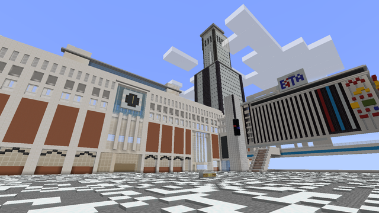
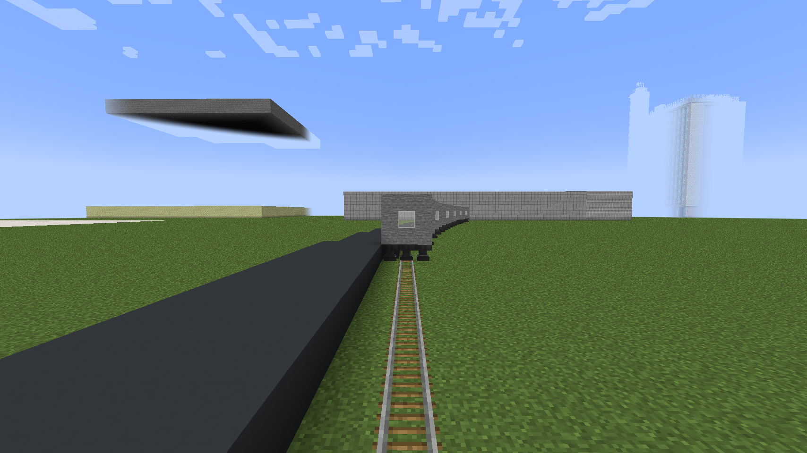

2025年

12月31日  
大学を作りました。講師を募集します。乗り物の使い方、TORO文学、WEの使い方や、保護の仕方などを教えてもらいたい  
講師になりたい方はStudiedsign2230に言って下さい。

2026年

1月1日  
図書館作った！！借りたい場合はStudiedsign2230に言ってね。  
行きたいなら/warps 山川県立双木図書館（借りたい場合はStudiedsign2230に言ってください。）  
1月2日  
開発メンバー募集中！  
南蛮県  
札幌駅再現  
入りたいならStudiedsign2230に言ってね。  
1月3日  
今日津田沼駅で撮り鉄に囲まれてしまった  
1月4日  
日記のような感覚だなこれ  
1月5日  
札幌駅再現楽しいな  
めっちゃ似てる  
メンバー 募集中です！  
  
1月6日  
江戸走り楽しい  
1月7日  
この画角好き  

