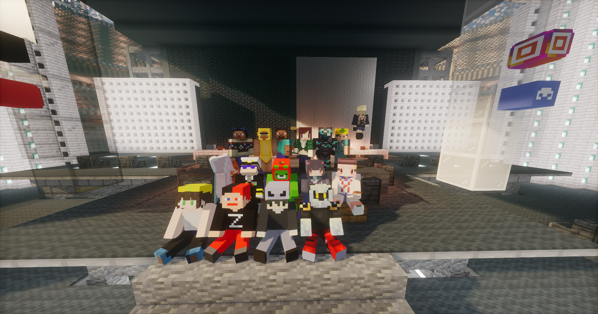
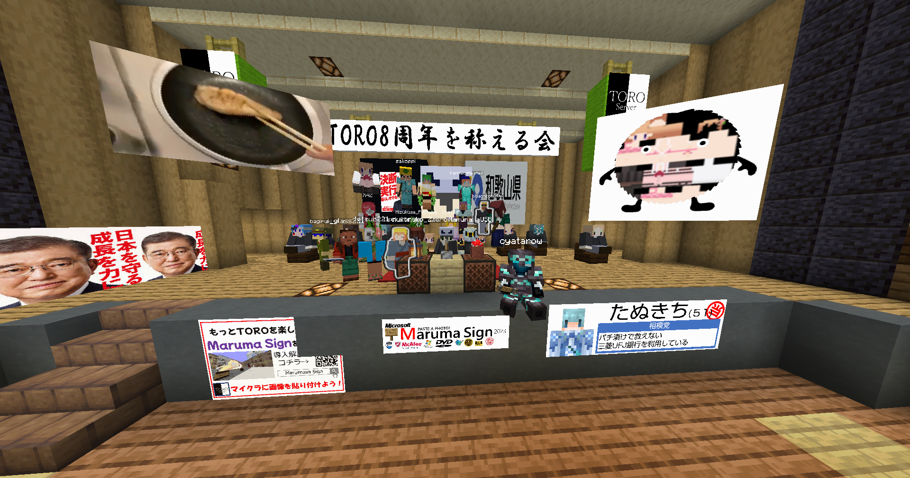
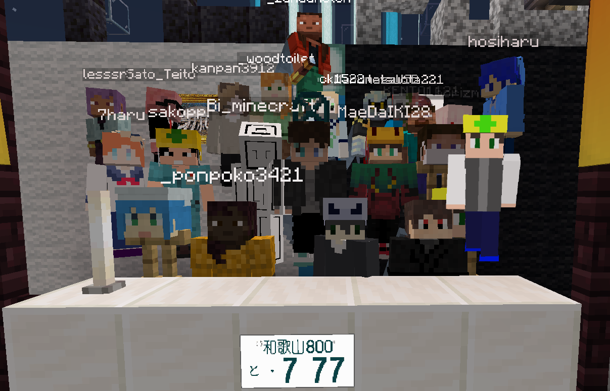
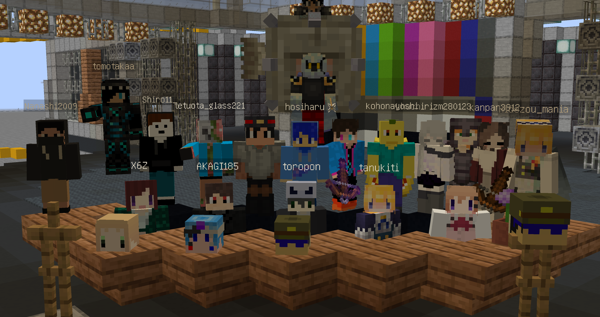
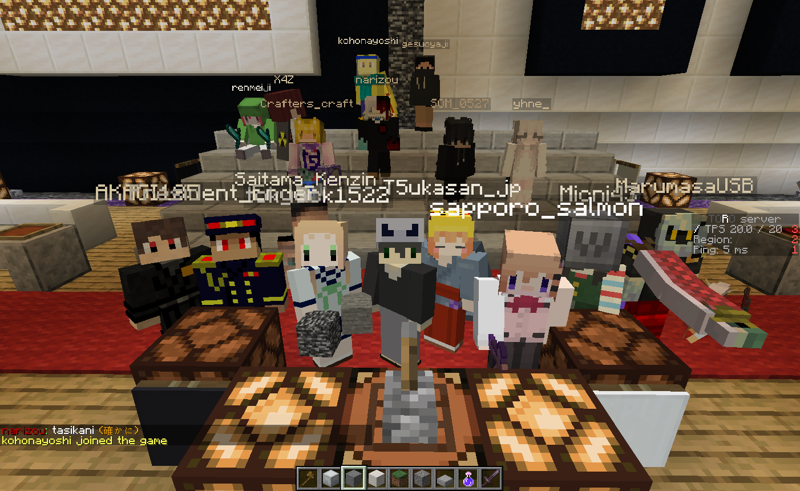
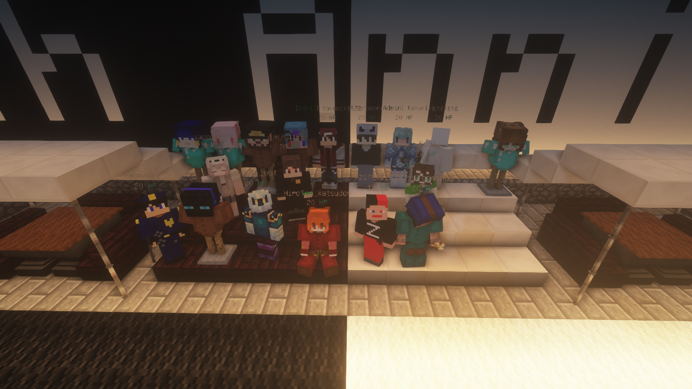
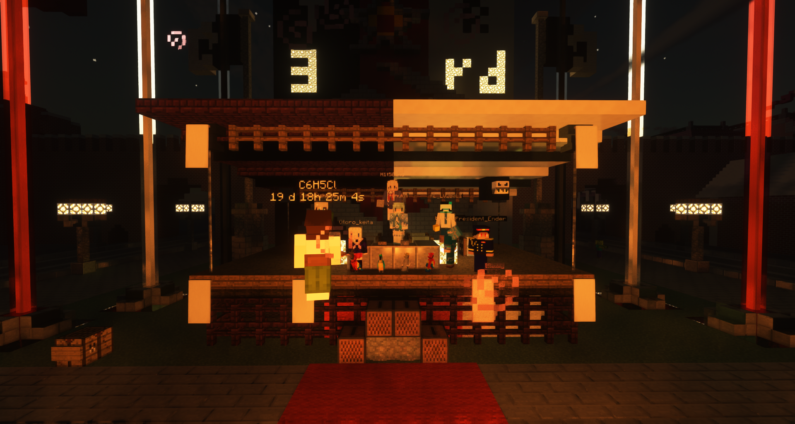
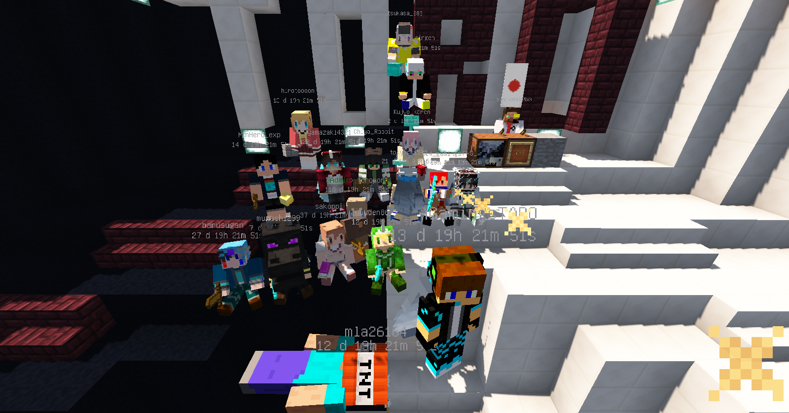

周年イベントとはTOROServerの恒例行事である。

## 目次

- [目次](#content_1)
- [概要](#content_2)
- [次回の式典](#content_3)
- [過去の式典](#content_4)
  - [9周年記念式典](#content_4_1)
  - [8周年記念式典](#content_4_2)
  - [7周年記念式典](#content_4_3)
  - [6周年記念式典](#content_4_4)
  - [5周年記念式典](#content_4_5)
  - [4周年記念式典](#content_4_6)
  - [3周年記念式典](#content_4_7)
  - [2周年記念式典 (鯖2周年記念建築大会)](#content_4_8)

## 概要

周年イベントあるいは周年式典とは、TOROServerで6周年より毎年7月に行われている式典である。  
毎年鯖主のtoropon氏が出席している。

## 次回の式典

次回(TOROServer10周年・⑨Server13周年)の式典は2027年(令和9年)7月に開催されます。

## 過去の式典

### 9周年記念式典

<table>
<tr><th>開催地</th><td>新形スタジアム</td></tr>
<tr><th>開催日</th><td>2026/7/27</td></tr>
<tr><th>主催者</th><td>bagiruki氏,kei1221氏</td></tr>
</table>

### 8周年記念式典

<table>
<tr><th>開催地</th><td>札幌のホール</td></tr>
<tr><th>開催日</th><td>2025/7/27</td></tr>
<tr><th>主催者</th><td>rupirupi_氏,bagiruki氏,MarumasaUSB氏</td></tr>
</table>

### 7周年記念式典

<table>
<tr><th>開催地</th><td>スポーン</td></tr>
<tr><th>開催日</th><td>2024/7/27</td></tr>
<tr><th>主催者</th><td>運営複数人</td></tr>
</table>

7周年に関しては[TORO鯖7周年/⑨鯖10周年記念特設ページ](../06_Community/TORO鯖7周年_⑨鯖10周年記念特設ページ.md)も参照せよ。

### 6周年記念式典

<table>
<tr><th>開催地</th><td><del>スポーン中央駅</del> 巴里</td></tr>
<tr><th>開催日</th><td>2023/7/30</td></tr>
<tr><th>主催者</th><td>tanuck1522氏を中心とした複数人</td></tr>
</table>

### 5周年記念式典

<table>
<tr><th>開催地</th><td>石北町石北文化ホール</td></tr>
<tr><th>開催日</th><td>2022/7/30</td></tr>
<tr><th>主催者</th><td>AKAGI185氏</td></tr>
</table>

### 4周年記念式典

<table>
<tr><th>開催地</th><td>燕谷</td></tr>
<tr><th>開催日</th><td>2021/7/24</td></tr>
<tr><th>主催者</th><td>tokyock1522氏</td></tr>
</table>

### 3周年記念式典

<table>
<tr><th>開催地</th><td>ソビエト</td></tr>
<tr><th>開催日</th><td>2020/7/22</td></tr>
<tr><th>主催者</th><td>President_Ender</td></tr>
</table>

### 2周年記念式典 (鯖2周年記念建築大会)

<table>
<tr><th>開催地</th><td>フラットワールド</td></tr>
<tr><th>開催日</th><td>2019/7/22</td></tr>
<tr><th>主催者</th><td></td></tr>
</table>

